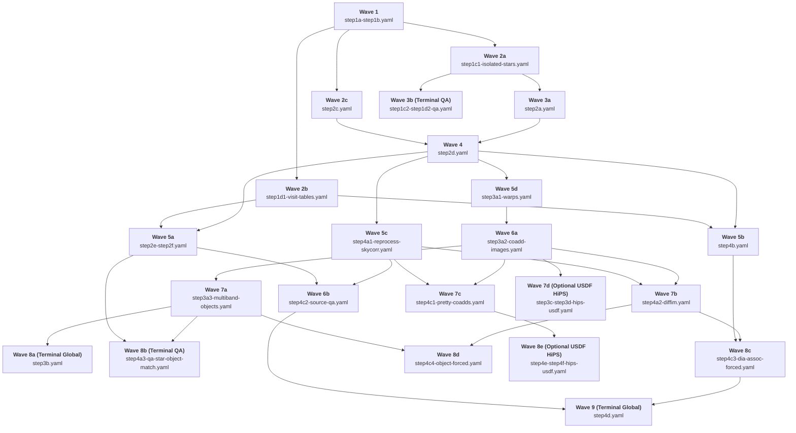

# Context (v2): LSST Data Release Production (DRP) Execution Graph & Downstream-First Prerequisite Guide

> **Pipeline Analyzed:** [`$DRP_PIPE_DIR/pipelines/LSSTCam/DRP-compat.yaml`](file:///home/dave/lsst_stack/v30_0_7/conda/envs/lsst-scipipe-12.2.0/share/eups/Linux64/drp_pipe/g165cd5a574+8ac013e155/pipelines/LSSTCam/DRP-compat.yaml) (which imports [`_ingredients/LSSTCam/DRP.yaml`](file:///home/dave/lsst_stack/v30_0_7/conda/envs/lsst-scipipe-12.2.0/share/eups/Linux64/drp_pipe/g165cd5a574+8ac013e155/pipelines/_ingredients/LSSTCam/DRP.yaml) $\rightarrow$ [`_ingredients/base-v2.yaml`](file:///home/dave/lsst_stack/v30_0_7/conda/envs/lsst-scipipe-12.2.0/share/eups/Linux64/drp_pipe/g165cd5a574+8ac013e155/pipelines/_ingredients/base-v2.yaml)) in `lsst_distrib` `v30_0_7` (`lsst-scipipe-12.2.0`).
>
> **Purpose of This Document:** This guide is organized from the **pipeline operator's (downstream-first) perspective**:
> 1. **"For any given step or task I want to run right now, what are its exact upstream prerequisites?"**
> 2. **"Can I run a 'later-named' step while 'earlier-named' steps are still running or not yet started?"**

---

## 1. Executive Summary: When Can You Run "Later-Named" Steps Before "Earlier-Named" Steps?

Step labels (`step1a` $\dots$ `step4f`) suggest a strict linear sequence, **but the actual execution graph is a wide DAG with 7 topological waves**. Many "later-named" steps have **zero dependency** on "earlier-named" steps and can be launched much earlier:

### 1.1 The 7 Topological Execution Waves (Step-Level Readiness)

Assuming you run each step in full as defined in `DRP-compat.yaml`, here is the earliest wave at which every step becomes runnable:

```text
Wave 1 (Start):
  └── step1a-single-visit-detectors (3 tasks)

Wave 2 (Ready as soon as step1a finishes):
  └── step1b-single-visit-visits (2 tasks)

Wave 3 (Ready as soon as step1b finishes — CAN RUN IN PARALLEL):
  ├── step1c-single-visit-tracts (2 tasks)
  └── step2c-recalibrate-healpix (1 task: GBDES astrometry)
      [!] Notice: step2c does NOT wait for step1c, step1d, or step2a!

Wave 4 (Ready as soon as step1c finishes — CAN RUN IN PARALLEL):
  ├── step1d-single-visit-global (4 tasks)
  └── step2a-recalibrate-global (3 tasks: FGCM photometry)
      [!] Notice: step2a does NOT wait for step1d or step2c!

Wave 5 (Ready as soon as step2a + step2c finish):
  └── step2d-recalibrate-visits (9 tasks)
      [!] Notice: step2d does NOT wait for step1d!

Wave 6 (Ready as soon as step2d [+ step1d] finish — 3 MAJOR BRANCHES RUN IN PARALLEL):
  ├── Branch A: step2e-recalibrate-tracts (2 tasks; requires step1d + step2d)
  ├── Branch B: step4b-generate-ephemerides-global (1 task; requires step1d + step2d)
  │   [!] Notice: step4b can run right after step1d + step2d! It does NOT wait for Stage 3 or step4a!
  └── Branch C: step3a-coadd-tracts (42 tasks; requires ONLY step1a + step2d)
      [!] Notice: step3a does NOT wait for step1d, step2e, or step2f!

Wave 7 (Downstream of Wave 6):
  ├── Ready after step2e:
  │     └── step2f-recalibrate-global (4 tasks; LEAF for production, feeds 1 QA task in 4a & 1 QA task in 4c)
  ├── Ready after step3a (ALL 3 CAN RUN IN PARALLEL):
  │     ├── step3b-coadd-global (11 tasks; TERMINAL LEAF — nothing in Stage 3 or Stage 4 waits for step3b)
  │     ├── step3c-coadd-gray-images (6 tasks) ──► step3d-coadd-hips (18 tasks; TERMINAL LEAF)
  │     └── step4a-measure-variability-visits (14 tasks; requires step3a + step2e + step2f [or only step3a if 1 QA task is excluded])
  └── Ready after step4a + step4b + step3a (+ step2e/2f for 1 QA task):
        └── step4c-measure-variability-tracts (19 tasks)
              ├── step4d-measure-variability-global (3 tasks; TERMINAL LEAF)
              └── step4e-measure-variability-rgb (3 tasks) ──► step4f-make-hips-from-rgb (6 tasks; TERMINAL LEAF)
```

### 1.2 Key Out-of-Order & Parallel Execution Rules

| Question ("Can I run X before Y?") | Answer | Why? (Exact Graph Reason) |
| :--- | :---: | :--- |
| **Can I run `step2c` before `step1c`, `step1d`, and `step2a`?** | **YES** | `gbdesHealpix3AstrometricFit` (`step2c`) only consumes `single_visit_star` and `preliminary_visit_summary` from **`step1b`**. |
| **Can I run `step2a` and `step2d` before `step1d`?** | **YES** | Neither `step2a` (FGCM) nor `step2d` (PSF refit, turbulence fit, `updateVisitSummary`, star recalibration) consumes anything from `step1d`. |
| **Can I run `step3a`, `step3b`, `step3c`, `step3d` before `step1d`, `step2e`, and `step2f`?** | **YES** | **The entire Stage 3 coadd pipeline (`step3a`–`step3d`) is 100% independent of `step1d`, `step2e`, and `step2f`.** `step3a` only needs `preliminary_visit_image` (`step1a`) and `visit_summary`, `recalibrated_star`, `refit_psf_star` (`step2d`). |
| **Can I run `step4b` before `step2e`, `step2f`, `step3a`–`step3d`, and `step4a`?** | **YES** | `generateEphemerides` (`step4b`) only consumes `preliminary_visit_table` (`step1d`) and `visit_summary` (`step2d`). It can run in Wave 6 alongside `step2e` and `step3a`. |
| **Can I run `step3c` $\rightarrow$ `step3d` and `step4a` $\rightarrow$ `step4f` before `step3b`?** | **YES** | `step3b-coadd-global` is a **terminal leaf step**; zero tasks in `step3c`, `step3d`, or Stage 4 consume its outputs. |
| **Can I run `step4a`–`step4f` before `step3c` and `step3d`?** | **YES** | `step3c` and `step3d` only build single-band grayscale images and HiPS tiles. Stage 4 has **zero** connection to `step3c` or `step3d`. |
| **Can I run `step4e` $\rightarrow$ `step4f` before `step4d`?** | **YES** | `step4d-measure-variability-global` is a **terminal leaf step**. |
| **Can I run `step4a` (Production DIA & Source table) before `step2e`, `step2f`, and before `step3a` finishes `Object` measurement?** | **YES (Subgraph level)** | 13 of the 14 tasks in `step4a` only require `step1a`, `step2d`, and `template_coadd` (`assembleTemplateCoadd` in `step3a`). Only 1 QA task in `step4a` (`analyzeRecalibratedStarObjectMatch`) waits for `step2e`, `step2f`, and `object_patch`/`object_epoch` (`step3a`). |

---

## 2. Master Downstream-First Step Prerequisite Table

This table reverses the traditional "producer $\rightarrow$ consumer" view. **Look up the step you want to run in the first column** to see:
1. Its **Direct Upstream Steps** (and the exact datasets & tasks that must exist in the Butler).
2. Its **Complete Transitive Step Prerequisites**.
3. Which **Earlier-Named Steps Are NOT Required** (steps you do *not* need to wait for).

| Target Step to Run | Direct Upstream Step Prerequisites & Required Datasets (`Consumer Task <- Dataset <- Producer Task`) | All Transitive Step Prerequisites | Earlier-Named Steps **NOT** Required |
| :--- | :--- | :--- | :--- |
| **`step1a-single-visit-detectors`**<br/>*(3 tasks, `{visit, detector}`)* | **None** *(Only Butler repo `raw` + calibration prerequisites: `bias`, `dark`, `flat`, `crosstalk`, `cti`, `defects`, `linearizer`, `ptc`, `gain_correction`, `electroBfDistortionMatrix`, `camera`, `astrometry_camera`, `the_monster_20250219`)* | None | None |
| **`step1b-single-visit-visits`**<br/>*(2 tasks, `{visit}`)* | **From `step1a`:**<ul><li>`consolidateVisitSummary` $\leftarrow$ `preliminary_visit_image` $\leftarrow$ `calibrateImage`</li><li>`consolidateSingleVisitStar` $\leftarrow$ `single_visit_star_detector` $\leftarrow$ `standardizeSingleVisitStar`</li></ul> | `1a` | None |
| **`step1c-single-visit-tracts`**<br/>*(2 tasks, `{tract}`)* | **From `step1b`:**<ul><li>`associateIsolatedStar`, `analyzeSingleVisitStarAssociation` $\leftarrow$ `single_visit_star` $\leftarrow$ `consolidateSingleVisitStar`</li></ul>*(Note: Does **not** require `consolidateVisitSummary` from `step1b`!)* | `1a, 1b` | None |
| **`step1d-single-visit-global`**<br/>*(4 tasks, `{}`)* | **From `step1b`:**<ul><li>`makeInitialVisitTable`, `makeInitialVisitDetectorTable` $\leftarrow$ `preliminary_visit_summary` $\leftarrow$ `consolidateVisitSummary`</li></ul>**From `step1c` (QA only):**<ul><li>`makeAnalysisSingleVisitStarAssociationMetricTable` $\leftarrow$ `single_visit_star_association_metrics` $\leftarrow$ `analyzeSingleVisitStarAssociation`</li></ul> | `1a, 1b, 1c`<br/>*(or `1a, 1b` for visit tables only)* | None |
| **`step2a-recalibrate-global`**<br/>*(3 tasks, `{}`)* | **From `step1b`:**<ul><li>`fgcmBuildFromIsolatedStar` $\leftarrow$ `preliminary_visit_summary` $\leftarrow$ `consolidateVisitSummary`</li></ul>**From `step1c`:**<ul><li>`fgcmBuildFromIsolatedStar` $\leftarrow$ `isolated_star`, `isolated_star_association` $\leftarrow$ `associateIsolatedStar`</li></ul> | `1a, 1b, 1c` | **`step1d`** |
| **`step2c-recalibrate-healpix`**<br/>*(1 task, `{healpix3}`)* | **From `step1b`:**<ul><li>`gbdesHealpix3AstrometricFit` $\leftarrow$ `preliminary_visit_summary` $\leftarrow$ `consolidateVisitSummary`</li><li>`gbdesHealpix3AstrometricFit` $\leftarrow$ `single_visit_star` $\leftarrow$ `consolidateSingleVisitStar`</li></ul> | `1a, 1b` | **`step1c, step1d, step2a`** |
| **`step2d-recalibrate-visits`**<br/>*(9 tasks, `{visit}`)* | **From `step1a`:**<ul><li>`refitPsfModelDetector`, `updateVisitSummary` $\leftarrow$ `preliminary_visit_image` $\leftarrow$ `calibrateImage`</li><li>`refitPsfModelDetector`, `recalibrateSingleVisitStar` $\leftarrow$ `single_visit_star_footprints` $\leftarrow$ `calibrateImage`</li></ul>**From `step1b`:**<ul><li>`updateVisitSummary` $\leftarrow$ `preliminary_visit_summary` $\leftarrow$ `consolidateVisitSummary`</li></ul>**From `step1c`:**<ul><li>`refitPsfModelDetector` $\leftarrow$ `isolated_star`, `isolated_star_association` $\leftarrow$ `associateIsolatedStar`</li></ul>**From `step2a`:**<ul><li>`updateVisitSummary` $\leftarrow$ `fgcmPhotoCalibCatalog` $\leftarrow$ `fgcmOutputProducts`</li></ul>**From `step2c`:**<ul><li>`gaussianProcessesTurbulenceFit` $\leftarrow$ `gbdesHealpix3AstrometricFitSkyWcsCatalog`, `gbdesHealpix3AstrometricFit_fitStars` $\leftarrow$ `gbdesHealpix3AstrometricFit`</li></ul> | `1a, 1b, 1c, 2a, 2c` | **`step1d`** |
| **`step2e-recalibrate-tracts`**<br/>*(2 tasks, `{tract}`)* | **From `step1b`:**<ul><li>`fitStellarMotion` $\leftarrow$ `preliminary_visit_summary` $\leftarrow$ `consolidateVisitSummary`</li></ul>**From `step1c`:**<ul><li>`fitStellarMotion`, `analyzeRecalibratedStarAssociation` $\leftarrow$ `isolated_star`, `isolated_star_association` $\leftarrow$ `associateIsolatedStar`</li></ul>**From `step1d`:**<ul><li>`fitStellarMotion`, `analyzeRecalibratedStarAssociation` $\leftarrow$ `preliminary_visit_table` $\leftarrow$ `makeInitialVisitTable`</li></ul>**From `step2d`:**<ul><li>`fitStellarMotion`, `analyzeRecalibratedStarAssociation` $\leftarrow$ `recalibrated_star` $\leftarrow$ `consolidateRecalibratedStar`</li></ul> | `1a, 1b, 1c, 1d, 2a, 2c, 2d` | None |
| **`step2f-recalibrate-global`**<br/>*(4 tasks, `{}`)* | **From `step2d`:**<ul><li>`makeVisitTable`, `makeVisitDetectorTable` $\leftarrow$ `visit_summary` $\leftarrow$ `updateVisitSummary`</li></ul>**From `step2e` (QA only):**<ul><li>`makeAnalysisRecalibratedStarAssociationMetricTable` $\leftarrow$ `recalibrated_star_association_metrics` $\leftarrow$ `analyzeRecalibratedStarAssociation`</li></ul> | `1a, 1b, 1c, 1d, 2a, 2c, 2d, 2e`<br/>*(or without `1d, 2e` for `visit_table` only)* | None *(or **`step1d, step2e`** if running `makeVisitTable` only)* |
| **`step3a-coadd-tracts`**<br/>*(42 tasks, `{tract}`)* | **From `step1a`:**<ul><li>`makeDirectWarp` $\leftarrow$ `preliminary_visit_image` $\leftarrow$ `calibrateImage`</li></ul>**From `step2d`:**<ul><li>`makeDirectWarp`, `selectDeepCoaddVisits`, `selectTemplateCoaddVisits`, `assembleCellCoadd`, `makeHealSparsePropertyMaps`, `measureObjectUnforced` $\leftarrow$ `visit_summary` $\leftarrow$ `updateVisitSummary`</li><li>`measureObjectUnforced` $\leftarrow$ `recalibrated_star` $\leftarrow$ `consolidateRecalibratedStar`</li><li>`measureObjectUnforced` $\leftarrow$ `refit_psf_star` $\leftarrow$ `consolidateRefitPsfModelDetector`</li></ul> | `1a, 1b, 1c, 2a, 2c, 2d` | **`step1d, step2e, step2f`** |
| **`step3b-coadd-global`**<br/>*(11 tasks, `{}`)* | **From `step3a`:**<ul><li>`consolidateHealSparsePropertyMaps` $\leftarrow$ 14 `deepCoadd_*` maps $\leftarrow$ `makeHealSparsePropertyMaps`</li><li>`makeDeepCoaddInputSummary` $\leftarrow$ `deep_coadd_input_summary_tract` $\leftarrow$ `makeDeepCoaddInputSummaryTract`</li><li>`makeTemplateCoaddInputSummary` $\leftarrow$ `template_coadd_input_summary_tract` $\leftarrow$ `makeTemplateCoaddInputSummaryTract`</li><li>`analyzeObjectTableSurveyCore` $\leftarrow$ `object_all` $\leftarrow$ `consolidateObject`</li><li>`makeMetricTableObjectTableCore` $\leftarrow$ `object_metrics` $\leftarrow$ `analyzeObjectTableCore`</li><li>`makeMetricTableObjectParentTableCore` $\leftarrow$ `object_parent_metrics` $\leftarrow$ `analyzeObjectParentTableCore`</li><li>`makeMetricTableObjectTableCoreRefCatMatch` $\leftarrow$ `object_ref_match_astrom_metrics` $\leftarrow$ `refCatObjectTract`</li></ul> | `1a, 1b, 1c, 2a, 2c, 2d, 3a` | **`step1d, step2e, step2f`** |
| **`step3c-coadd-gray-images`**<br/>*(6 tasks, `{}`)* | **From `step3a`:**<ul><li>`makeSingleBandRGBCoadd[U,G,R,I,Z,Y]` $\leftarrow$ `deep_coadd` $\leftarrow$ `detectCoaddPeaks`</li></ul> | `1a, 1b, 1c, 2a, 2c, 2d, 3a` | **`step1d, step2e, step2f, step3b`** |
| **`step3d-coadd-hips`**<br/>*(18 tasks, `{}`)* | **From `step3c`:**<ul><li>`makeHighOrderHips[U,G,R,I,Z,Y]` $\leftarrow$ `deep_coadd_[u,g,r,i,z,y]_gray` $\leftarrow$ `makeSingleBandRGBCoadd[U,G,R,I,Z,Y]`</li></ul> | `1a, 1b, 1c, 2a, 2c, 2d, 3a, 3c` | **`step1d, step2e, step2f, step3b`** |
| **`step4a-measure-variability-visits`**<br/>*(14 tasks, `{visit}`)* | **Production Tasks (13 of 14 tasks):**<ul><li>**From `step1a`:** `reprocessVisitImage` $\leftarrow$ `post_isr_image` (`isr`), `preliminary_visit_mask` & `preliminary_visit_image_background` (`calibrateImage`); `skyCorr` $\leftarrow$ `preliminary_visit_image` & `preliminary_visit_image_background` (`calibrateImage`); `subtractImages` $\leftarrow$ `single_visit_star_footprints` (`calibrateImage`)</li><li>**From `step2d`:** `reprocessVisitImage` $\leftarrow$ `visit_summary` (`updateVisitSummary`), `refit_psf_star` (`consolidateRefitPsfModelDetector`)</li><li>**From `step3a`:** `buildTemplate` $\leftarrow$ `template_coadd` (`assembleTemplateCoadd`)</li></ul>**Single QA Task (`analyzeRecalibratedStarObjectMatch`):**<ul><li>**From `step1c`:** `isolated_star`, `isolated_star_association` (`associateIsolatedStar`)</li><li>**From `step2d`:** `recalibrated_star` (`consolidateRecalibratedStar`)</li><li>**From `step2e`:** `isolated_star_stellar_motions` (`fitStellarMotion`)</li><li>**From `step2f`:** `visit_table` (`makeVisitTable`)</li><li>**From `step3a`:** `object_patch` (`standardizeObject`), `object_epoch` (`computeObjectEpochs`)</li></ul> | `1a, 1b, 1c, 1d, 2a, 2c, 2d, 2e, 2f, 3a`<br/>*(or **`1a, 1b, 1c, 2a, 2c, 2d, 3a`** without `analyzeRecalibratedStarObjectMatch`)* | **`step3b, step3c, step3d`**<br/>*(plus **`step1d, step2e, step2f`** if `analyzeRecalibratedStarObjectMatch` is excluded)* |
| **`step4b-generate-ephemerides-global`**<br/>*(1 task, `{}`)* | **From `step1d`:**<ul><li>`generateEphemerides` $\leftarrow$ `preliminary_visit_table` $\leftarrow$ `makeInitialVisitTable`</li></ul>**From `step2d`:**<ul><li>`generateEphemerides` $\leftarrow$ `visit_summary` $\leftarrow$ `updateVisitSummary`</li></ul> | `1a, 1b, 1c, 1d, 2a, 2c, 2d` | **`step2e, step2f, step3a, step3b, step3c, step3d, step4a`** |
| **`step4c-measure-variability-tracts`**<br/>*(19 tasks, `{tract}`)* | **From `step2d`:**<ul><li>`associateDiaSource`, `makePrettyDirectWarp` $\leftarrow$ `visit_summary` $\leftarrow$ `updateVisitSummary`</li></ul>**From `step3a`:**<ul><li>`assemblePrettyCoadd` $\leftarrow$ `deep_coadd_visit_selection` $\leftarrow$ `selectDeepCoaddVisits`</li><li>`forcedPhotObjectDetector`, `standardizeObjectForcedSource` $\leftarrow$ `object_patch` $\leftarrow$ `standardizeObject`</li></ul>**From `step4a`:**<ul><li>`associateDiaSource` $\leftarrow$ `dia_source_detector` $\leftarrow$ `standardizeDiaSource`</li><li>`forcedPhotDiaObjectDetector`, `forcedPhotObjectDetector` $\leftarrow$ `difference_image` $\leftarrow$ `detectAndMeasureDiaSource`</li><li>`forcedPhotDiaObjectDetector`, `forcedPhotObjectDetector`, `makePrettyDirectWarp` $\leftarrow$ `visit_image` $\leftarrow$ `reprocessVisitImage`</li><li>`makePrettyDirectWarp` $\leftarrow$ `skyCorr` $\leftarrow$ `skyCorr`</li><li>`associateAnalysisSource`, `analyzeSourceAssociation` $\leftarrow$ `source_all` $\leftarrow$ `consolidateSource`</li></ul>**From `step4b`:**<ul><li>`associateDiaSource` $\leftarrow$ `preloaded_ss_object_visit` $\leftarrow$ `generateEphemerides`</li></ul>**From `step2e` & `step2f` (QA task `analyzeSourceAssociation` only):**<ul><li>`analyzeSourceAssociation` $\leftarrow$ `isolated_star_stellar_motions` (`fitStellarMotion` in `step2e`) & `visit_table` (`makeVisitTable` in `step2f`)</li></ul> | `1a, 1b, 1c, 1d, 2a, 2c, 2d, 2e, 2f, 3a, 4a, 4b` | **`step3b, step3c, step3d`** |
| **`step4d-measure-variability-global`**<br/>*(3 tasks, `{}`)* | **From `step4c`:**<ul><li>`consolidateSsTables` $\leftarrow$ `ss_source_associated` $\leftarrow$ `associateDiaSource`</li><li>`makeAnalysisSourceAssociationMetricTable` $\leftarrow$ `analysis_source_association_metrics` $\leftarrow$ `analyzeSourceAssociation`</li></ul> | `1a..2f, 3a, 4a, 4b, 4c` | **`step3b, step3c, step3d`** |
| **`step4e-measure-variability-rgb`**<br/>*(3 tasks, `{}`)* | **From `step4c`:**<ul><li>`fixBackgroundPrettyCoadd` $\leftarrow$ `pretty_coadd` $\leftarrow$ `assemblePrettyCoadd`</li></ul> | `1a..2d, 3a, 4a, 4c` | **`step3b, step3c, step3d, step4b, step4d`** |
| **`step4f-make-hips-from-rgb`**<br/>*(6 tasks, `{}`)* | **From `step4e`:**<ul><li>`makeHighOrderHipsGRI`, `makeHighOrderHipsEpoGRI` $\leftarrow$ `pretty_coadd_gri` $\leftarrow$ `makeRGBPicturePrettyCoaddGRI`</li></ul> | `1a..2d, 3a, 4a, 4c, 4e` | **`step3b, step3c, step3d, step4b, step4d`** |

---

## 3. Detailed Downstream-First Reference for Every Step, Subgraph, & Task

In every table below, **tasks are listed with their exact upstream requirements first** (`Required Upstream Inputs (Internal & Cross-Step)`), so you can immediately verify what must exist before running any step, subgraph, or individual task.

---

### Stage 1: Single-Visit Processing (`stage1-single-visit`)

#### `step1a-single-visit-detectors`
* **Sharding Dimensions:** `[visit, detector]` $\rightarrow$ `{band, instrument, day_obs, detector, physical_filter, visit}`
* **Step-Level Upstream Prerequisites:** **None** (initial pipeline entry point).
* **Internal Subgraphs:** **1 connected component (3 tasks)**

| Task Label | Task Dimensions | Required Upstream Inputs (Internal & Cross-Step) | Outputs Produced (and Who Needs Them Later) |
| :--- | :--- | :--- | :--- |
| **`isr`** | `{detector, exposure}` | **Repo/Prereq only:** `raw` [init], `bias`, `dark`, `flat`, `crosstalk`, `cti`, `defects`, `linearizer`, `ptc`, `gain_correction`, `electroBfDistortionMatrix`, `camera` | <ul><li>`post_isr_image` $\rightarrow$ needed by `calibrateImage` (`1a`), `reprocessVisitImage` (`4a`)</li><li>`isrStatistics` *(terminal)*</li></ul> |
| **`calibrateImage`** | `{detector, visit}` | <ul><li>**Internal (`1a`):** `post_isr_image` ($\leftarrow$ `isr`)</li><li>**Prereq:** `astrometry_camera`, `the_monster_20250219`</li></ul> | <ul><li>`single_visit_star_unstandardized` $\rightarrow$ needed by `standardizeSingleVisitStar` (`1a`)</li><li>`preliminary_visit_image` $\rightarrow$ needed by `consolidateVisitSummary` (`1b`), `refitPsfModelDetector` & `updateVisitSummary` (`2d`), `makeDirectWarp` (`3a`), `skyCorr` (`4a`)</li><li>`preliminary_visit_image_background` $\rightarrow$ needed by `reprocessVisitImage` & `skyCorr` (`4a`)</li><li>`preliminary_visit_mask` $\rightarrow$ needed by `reprocessVisitImage` (`4a`)</li><li>`single_visit_star_footprints` $\rightarrow$ needed by `refitPsfModelDetector` & `recalibrateSingleVisitStar` (`2d`), `subtractImages` (`4a`)</li><li>`initial_astrometry_match_detector`, `initial_photometry_match_detector`, `single_visit_psf_star`, `single_visit_psf_star_footprints` *(terminal)*</li></ul> |
| **`standardizeSingleVisitStar`** | `{detector, visit}` | <ul><li>**Internal (`1a`):** `single_visit_star_unstandardized` ($\leftarrow$ `calibrateImage`)</li></ul> | <ul><li>`single_visit_star_detector` $\rightarrow$ needed by `consolidateSingleVisitStar` (`1b`)</li></ul> |

---

#### `step1b-single-visit-visits`
* **Sharding Dimensions:** `[visit]` $\rightarrow$ `{band, instrument, day_obs, physical_filter, visit}`
* **Step-Level Upstream Prerequisites:** Requires **`step1a`**.
* **Internal Subgraphs:** **2 mutually independent subgraphs (2 tasks)** — can run independently of each other:

| Subgraph | Task Label | Task Dimensions | Required Upstream Inputs (Internal & Cross-Step) | Outputs Produced (and Who Needs Them Later) |
| :--- | :--- | :--- | :--- | :--- |
| **Subgraph 1** *(Star Catalog)* | **`consolidateSingleVisitStar`** | `{visit}` | <ul><li>**From `step1a`:** `single_visit_star_detector` ($\leftarrow$ `standardizeSingleVisitStar`)</li></ul>*(Does **not** need `consolidateVisitSummary`)* | <ul><li>`single_visit_star` $\rightarrow$ needed by `associateIsolatedStar` & `analyzeSingleVisitStarAssociation` (`1c`), `gbdesHealpix3AstrometricFit` (`2c`)</li></ul> |
| **Subgraph 2** *(Visit Summary)* | **`consolidateVisitSummary`** | `{visit}` | <ul><li>**From `step1a`:** `preliminary_visit_image` ($\leftarrow$ `calibrateImage`)</li><li>**Prereq:** `camera`</li></ul>*(Does **not** need `standardizeSingleVisitStar` or `consolidateSingleVisitStar`)* | <ul><li>`preliminary_visit_summary` $\rightarrow$ needed by `makeInitialVisitTable` & `makeInitialVisitDetectorTable` (`1d`), `fgcmBuildFromIsolatedStar` (`2a`), `gbdesHealpix3AstrometricFit` (`2c`), `updateVisitSummary` (`2d`), `fitStellarMotion` (`2e`)</li><li>`visit_geometry` *(terminal)*</li></ul> |

---

#### `step1c-single-visit-tracts`
* **Sharding Dimensions:** `[tract]` $\rightarrow$ `{skymap, tract}`
* **Step-Level Upstream Prerequisites:** Requires **`step1a` $\rightarrow$ `step1b` (`consolidateSingleVisitStar`)**.
* **Internal Subgraphs:** **1 connected component (2 tasks)**

| Task Label | Task Dimensions | Required Upstream Inputs (Internal & Cross-Step) | Outputs Produced (and Who Needs Them Later) |
| :--- | :--- | :--- | :--- |
| **`associateIsolatedStar`** | `{instrument, skymap, tract}` | <ul><li>**From `step1b`:** `single_visit_star` ($\leftarrow$ `consolidateSingleVisitStar`)</li><li>**Repo:** `skyMap`</li></ul> | <ul><li>`isolated_star`, `isolated_star_association` $\rightarrow$ needed by `analyzeSingleVisitStarAssociation` (`1c`), `fgcmBuildFromIsolatedStar` (`2a`), `refitPsfModelDetector` (`2d`), `fitStellarMotion` & `analyzeRecalibratedStarAssociation` (`2e`), `analyzeRecalibratedStarObjectMatch` (`4a`)</li></ul> |
| **`analyzeSingleVisitStarAssociation`** | `{instrument, skymap, tract}` | <ul><li>**Internal (`1c`):** `isolated_star`, `isolated_star_association` ($\leftarrow$ `associateIsolatedStar`)</li><li>**From `step1b`:** `single_visit_star` ($\leftarrow$ `consolidateSingleVisitStar`)</li><li>**Repo/Prereq:** `skyMap`, `camera`</li></ul> | <ul><li>`single_visit_star_association_metrics` $\rightarrow$ needed by `makeAnalysisSingleVisitStarAssociationMetricTable` (`1d`)</li><li>13 tract-level astrometric/photometric repeatability plots *(terminal)*</li></ul> |

---

#### `step1d-single-visit-global`
* **Sharding Dimensions:** `[]` (global)
* **Step-Level Upstream Prerequisites:** Requires **`step1b`** (for Subgraphs 2 & 3) and **`step1c`** (for Subgraph 1).
* **Internal Subgraphs:** **3 mutually independent subgraphs (4 tasks)**
  * *Out-of-Order Note:* Subgraphs 2 and 3 (`makeInitialVisitDetectorTable` and `makeInitialVisitTable`) **only depend on `consolidateVisitSummary` (`step1b`)**—they do **not** require `step1c`!

| Subgraph | Task Label | Task Dimensions | Required Upstream Inputs (Internal & Cross-Step) | Outputs Produced (and Who Needs Them Later) |
| :--- | :--- | :--- | :--- | :--- |
| **Subgraph 1** *(Whole-Sky Star Assoc QA)* | **`makeAnalysisSingleVisitStarAssociationMetricTable`** | `{skymap}` | <ul><li>**From `step1c`:** `single_visit_star_association_metrics` ($\leftarrow$ `analyzeSingleVisitStarAssociation`)</li><li>**Repo:** `skyMap`</li></ul> | <ul><li>`single_visit_star_association_metrics_table` $\rightarrow$ needed by `makeAnalysisSingleVisitStarAssociationWholeSkyPlot` (`1d`)</li></ul> |
| | **`makeAnalysisSingleVisitStarAssociationWholeSkyPlot`** | `{skymap}` | <ul><li>**Internal (`1d`):** `single_visit_star_association_metrics_table` ($\leftarrow$ `makeAnalysisSingleVisitStarAssociationMetricTable`)</li><li>**Repo:** `skyMap`</li></ul> | <ul><li>16 whole-sky repeatability/residual plots *(terminal)*</li></ul> |
| **Subgraph 2** *(Initial Detector Table)* | **`makeInitialVisitDetectorTable`** | `{instrument}` | <ul><li>**From `step1b`:** `preliminary_visit_summary` ($\leftarrow$ `consolidateVisitSummary`)</li></ul>*(Does **not** require `step1c`)* | <ul><li>`preliminary_visit_detector_table` *(terminal)*</li></ul> |
| **Subgraph 3** *(Initial Visit Table)* | **`makeInitialVisitTable`** | `{instrument}` | <ul><li>**From `step1b`:** `preliminary_visit_summary` ($\leftarrow$ `consolidateVisitSummary`)</li></ul>*(Does **not** require `step1c`)* | <ul><li>`preliminary_visit_table` $\rightarrow$ needed by `fitStellarMotion` & `analyzeRecalibratedStarAssociation` (`2e`), and `generateEphemerides` (`4b`)</li></ul> |

---

### Stage 2: Multi-Epoch Recalibration (`stage2-recalibrate`)

#### `step2a-recalibrate-global` (FGCM Global Photometric Calibration)
* **Sharding Dimensions:** `[]` (global `{instrument}`)
* **Step-Level Upstream Prerequisites:** Requires **`step1a` $\rightarrow$ `step1b` $\rightarrow$ `step1c`**. (**Does NOT require `step1d` or `step2c`!**)
* **Internal Subgraphs:** **1 connected component (3 tasks)**

| Task Label | Task Dimensions | Required Upstream Inputs (Internal & Cross-Step) | Outputs Produced (and Who Needs Them Later) |
| :--- | :--- | :--- | :--- |
| **`fgcmBuildFromIsolatedStar`** | `{instrument}` | <ul><li>**From `step1b`:** `preliminary_visit_summary` ($\leftarrow$ `consolidateVisitSummary`)</li><li>**From `step1c`:** `isolated_star`, `isolated_star_association` ($\leftarrow$ `associateIsolatedStar`)</li><li>**Prereq:** `camera`, `fgcmLookUpTable`, `the_monster_20250219`</li></ul> | <ul><li>`fgcmVisitCatalog` $\rightarrow$ needed by `fgcmFitCycle` & `fgcmOutputProducts` (`2a`)</li><li>`fgcm_reference_stars`, `fgcm_star_ids`, `fgcm_star_observations` $\rightarrow$ needed by `fgcmFitCycle` (`2a`)</li></ul> |
| **`fgcmFitCycle`** | `{instrument}` | <ul><li>**Internal (`2a`):** `fgcmVisitCatalog`, `fgcm_reference_stars`, `fgcm_star_ids`, `fgcm_star_observations` ($\leftarrow$ `fgcmBuildFromIsolatedStar`)</li><li>**Prereq:** `camera`, `fgcmLookUpTable`</li></ul> | <ul><li>`fgcm_Cycle5_AtmosphereParameters`, `fgcm_Cycle5_StandardStars`, `fgcm_Cycle5_Zeropoints` $\rightarrow$ needed by `fgcmOutputProducts` (`2a`)</li><li>Cycle 0–5 fit parameters, flagged stars, configs, and QA plots *(terminal)*</li></ul> |
| **`fgcmOutputProducts`** | `{instrument}` | <ul><li>**Internal (`2a`):** `fgcmVisitCatalog` ($\leftarrow$ `fgcmBuildFromIsolatedStar`); `fgcm_Cycle5_AtmosphereParameters`, `fgcm_Cycle5_StandardStars`, `fgcm_Cycle5_Zeropoints` ($\leftarrow$ `fgcmFitCycle`)</li><li>**Repo/Prereq:** `skyMap`, `camera`, `fgcmLookUpTable`</li></ul> | <ul><li>**`fgcmPhotoCalibCatalog`** $\rightarrow$ needed by `updateVisitSummary` (`2d`)</li><li>`fgcm_standard_star`, `transmission_atmosphere_fgcm` *(terminal)*</li></ul> |

---

#### `step2c-recalibrate-healpix` (GBDES Multi-Visit Astrometric Fit)
* **Sharding Dimensions:** `[healpix3]` $\rightarrow$ `{band, healpix3, instrument, physical_filter}`
* **Step-Level Upstream Prerequisites:** Requires **ONLY `step1a` $\rightarrow$ `step1b`**. (**Does NOT require `step1c`, `step1d`, or `step2a`!** Can run in Wave 3 concurrently with `step1c`.)
* **Internal Subgraphs:** **1 connected component (1 task)**

| Task Label | Task Dimensions | Required Upstream Inputs (Internal & Cross-Step) | Outputs Produced (and Who Needs Them Later) |
| :--- | :--- | :--- | :--- |
| **`gbdesHealpix3AstrometricFit`** | `{band, healpix3, instrument, physical_filter}` | <ul><li>**From `step1b`:** `preliminary_visit_summary` ($\leftarrow$ `consolidateVisitSummary`)</li><li>**From `step1b`:** `single_visit_star` ($\leftarrow$ `consolidateSingleVisitStar`)</li><li>**Prereq:** `the_monster_20250219`</li></ul> | <ul><li>**`gbdesHealpix3AstrometricFitSkyWcsCatalog`**, **`gbdesHealpix3AstrometricFit_fitStars`** $\rightarrow$ needed by `gaussianProcessesTurbulenceFit` (`2d`)</li><li>`gbdesHealpix3AstrometricFit_starCatalog` *(terminal)*</li></ul> |

---

#### `step2d-recalibrate-visits` (PSF Refit, Turbulence Fit, Visit Summary Update, & Star Recalibration)
* **Sharding Dimensions:** `[visit]` $\rightarrow$ `{band, instrument, day_obs, physical_filter, visit}`
* **Step-Level Upstream Prerequisites:** Requires **`step1a`, `step1b`, `step1c`, `step2a`, `step2c`**. (**Does NOT require `step1d`!**)
* **Internal Subgraphs:** **1 connected component (9 tasks)** — However, its two initial branches (`refitPsfModelDetector` and `gaussianProcessesTurbulenceFit`) have partial prerequisites and could even run before `step2a` finishes:
  * `refitPsfModelDetector` $\rightarrow$ `consolidateRefitPsfModelDetector` **only needs `step1a` + `step1c`** (does not need `step2a` or `step2c`!).
  * `gaussianProcessesTurbulenceFit` **only needs `step2c`** (does not need `step1c` or `step2a`!).
  * `updateVisitSummary` is where `step1a`, `step1b`, `step1c` (via `refitPsfModelDetector`), `step2a`, and `step2c` (via `gaussianProcessesTurbulenceFit`) converge.

| Task Label | Task Dimensions | Required Upstream Inputs (Internal & Cross-Step) | Outputs Produced (and Who Needs Them Later) |
| :--- | :--- | :--- | :--- |
| **`refitPsfModelDetector`** | `{detector, visit}` | <ul><li>**From `step1a`:** `preliminary_visit_image`, `single_visit_star_footprints` ($\leftarrow$ `calibrateImage`)</li><li>**From `step1c`:** `isolated_star`, `isolated_star_association` ($\leftarrow$ `associateIsolatedStar`)</li></ul>*(Does **not** need `2a` or `2c`)* | <ul><li>`refit_psf_models_detector`, `refit_psf_star_detector` $\rightarrow$ needed by `consolidateRefitPsfModelDetector` (`2d`)</li></ul> |
| **`consolidateRefitPsfModelDetector`** | `{visit}` | <ul><li>**Internal (`2d`):** `refit_psf_models_detector`, `refit_psf_star_detector` ($\leftarrow$ `refitPsfModelDetector`)</li></ul> | <ul><li>**`refit_psf_models`** $\rightarrow$ needed by `updateVisitSummary` (`2d`)</li><li>**`refit_psf_star`** $\rightarrow$ needed by `updateVisitSummary` (`2d`), `measureObjectUnforced` (`3a`), `reprocessVisitImage` (`4a`)</li></ul> |
| **`gaussianProcessesTurbulenceFit`** | `{healpix3, visit}` | <ul><li>**From `step2c`:** `gbdesHealpix3AstrometricFitSkyWcsCatalog`, `gbdesHealpix3AstrometricFit_fitStars` ($\leftarrow$ `gbdesHealpix3AstrometricFit`)</li></ul>*(Does **not** need `1c` or `2a`)* | <ul><li>**`turbulenceCorrectedSkyWcsCatalog`** $\rightarrow$ needed by `updateVisitSummary` (`2d`)</li><li>`turbulence_fit_hyperparameters` *(terminal)*</li></ul> |
| **`updateVisitSummary`** | `{visit}` | <ul><li>**From `step1a`:** `preliminary_visit_image` ($\leftarrow$ `calibrateImage`)</li><li>**From `step1b`:** `preliminary_visit_summary` ($\leftarrow$ `consolidateVisitSummary`)</li><li>**From `step2a`:** `fgcmPhotoCalibCatalog` ($\leftarrow$ `fgcmOutputProducts`)</li><li>**Internal (`2d`):** `refit_psf_models`, `refit_psf_star` ($\leftarrow$ `consolidateRefitPsfModelDetector`)</li><li>**Internal (`2d`):** `turbulenceCorrectedSkyWcsCatalog` ($\leftarrow$ `gaussianProcessesTurbulenceFit`)</li><li>**Repo/Prereq:** `skyMap`, `camera`</li></ul> | <ul><li>**`visit_summary`** $\rightarrow$ needed by:<ul><li>`recalibrateSingleVisitStar` & `makeAnalysisRecalibratedStarAstrometricRefMatch` (`2d`)</li><li>`makeVisitTable` & `makeVisitDetectorTable` (`2f`)</li><li>`makeDirectWarp`, `selectDeepCoaddVisits`, `selectTemplateCoaddVisits`, `assembleCellCoadd`, `makeHealSparsePropertyMaps`, `measureObjectUnforced` (`3a`)</li><li>`reprocessVisitImage` (`4a`)</li><li>`generateEphemerides` (`4b`)</li><li>`associateDiaSource`, `makePrettyDirectWarp` (`4c`)</li></ul></li></ul> |
| **`recalibrateSingleVisitStar`** | `{skymap, detector, visit}` | <ul><li>**From `step1a`:** `single_visit_star_footprints` ($\leftarrow$ `calibrateImage`)</li><li>**Internal (`2d`):** `visit_summary` ($\leftarrow$ `updateVisitSummary`)</li></ul> | <ul><li>`recalibrated_star_unstandardized` $\rightarrow$ needed by `standardizeRecalibratedStar` (`2d`)</li></ul> |
| **`standardizeRecalibratedStar`** | `{detector, visit}` | <ul><li>**Internal (`2d`):** `recalibrated_star_unstandardized` ($\leftarrow$ `recalibrateSingleVisitStar`)</li></ul> | <ul><li>`recalibrated_star_detector` $\rightarrow$ needed by `consolidateRecalibratedStar` (`2d`)</li></ul> |
| **`consolidateRecalibratedStar`** | `{visit}` | <ul><li>**Internal (`2d`):** `recalibrated_star_detector` ($\leftarrow$ `standardizeRecalibratedStar`)</li></ul> | <ul><li>**`recalibrated_star`** $\rightarrow$ needed by `makeAnalysisRecalibratedStarAstrometricRefMatch` (`2d`), `fitStellarMotion` & `analyzeRecalibratedStarAssociation` (`2e`), `measureObjectUnforced` (`3a`), `analyzeRecalibratedStarObjectMatch` (`4a`)</li></ul> |
| **`makeAnalysisRecalibratedStarAstrometricRefMatch`** | `{visit}` | <ul><li>**Internal (`2d`):** `visit_summary` ($\leftarrow$ `updateVisitSummary`), `recalibrated_star` ($\leftarrow$ `consolidateRecalibratedStar`)</li><li>**Prereq:** `the_monster_20250219`</li></ul> | <ul><li>`recalibrated_star_ref_match_astrom` $\rightarrow$ needed by `analyzeRecalibratedStarAstrometricRefMatch` (`2d`)</li></ul> |
| **`analyzeRecalibratedStarAstrometricRefMatch`** | `{visit}` | <ul><li>**Internal (`2d`):** `recalibrated_star_ref_match_astrom` ($\leftarrow$ `makeAnalysisRecalibratedStarAstrometricRefMatch`)</li></ul> | <ul><li>`recalibrated_star_ref_match_astrom_metrics` *(terminal)*</li></ul> |

---

#### `step2e-recalibrate-tracts` (Stellar Motion & Recalibrated Star Association QA)
* **Sharding Dimensions:** `[tract]` $\rightarrow$ `{skymap, tract}`
* **Step-Level Upstream Prerequisites:** Requires **`step1b`, `step1c`, `step1d` (`makeInitialVisitTable`), and `step2d` (`consolidateRecalibratedStar`)**.
* **Internal Subgraphs:** **1 connected component (2 tasks)**

| Task Label | Task Dimensions | Required Upstream Inputs (Internal & Cross-Step) | Outputs Produced (and Who Needs Them Later) |
| :--- | :--- | :--- | :--- |
| **`fitStellarMotion`** | `{instrument, skymap, tract}` | <ul><li>**From `step1b`:** `preliminary_visit_summary` ($\leftarrow$ `consolidateVisitSummary`)</li><li>**From `step1c`:** `isolated_star`, `isolated_star_association` ($\leftarrow$ `associateIsolatedStar`)</li><li>**From `step1d`:** `preliminary_visit_table` ($\leftarrow$ `makeInitialVisitTable`)</li><li>**From `step2d`:** `recalibrated_star` ($\leftarrow$ `consolidateRecalibratedStar`)</li><li>**Repo/Prereq:** `skyMap`, `the_monster_20250219`</li></ul> | <ul><li>**`isolated_star_stellar_motions`** $\rightarrow$ needed by `analyzeRecalibratedStarAssociation` (`2e`), `analyzeRecalibratedStarObjectMatch` (`4a`), `analyzeSourceAssociation` (`4c`)</li><li>`isolated_star_predicted_positions` *(terminal)*</li></ul> |
| **`analyzeRecalibratedStarAssociation`** | `{instrument, skymap, tract}` | <ul><li>**Internal (`2e`):** `isolated_star_stellar_motions` ($\leftarrow$ `fitStellarMotion`)</li><li>**From `step1c`:** `isolated_star`, `isolated_star_association` ($\leftarrow$ `associateIsolatedStar`)</li><li>**From `step1d`:** `preliminary_visit_table` ($\leftarrow$ `makeInitialVisitTable`)</li><li>**From `step2d`:** `recalibrated_star` ($\leftarrow$ `consolidateRecalibratedStar`)</li><li>**Repo/Prereq:** `skyMap`, `camera`</li></ul> | <ul><li>`recalibrated_star_association_metrics` $\rightarrow$ needed by `makeAnalysisRecalibratedStarAssociationMetricTable` (`2f`)</li><li>13 tract-level recalibrated star QA plots *(terminal)*</li></ul> |

---

#### `step2f-recalibrate-global` (Final Survey Visit Tables & Whole-Sky QA)
* **Sharding Dimensions:** `[]` (global)
* **Step-Level Upstream Prerequisites:** Requires **`step2d`** (for Subgraphs 2 & 3) and **`step2e`** (for Subgraph 1).
* **Internal Subgraphs:** **3 mutually independent subgraphs (4 tasks)**
  * *Out-of-Order Note:* **`makeVisitTable` and `makeVisitDetectorTable` (Subgraphs 2 & 3) only require `visit_summary` from `step2d`!** They do **not** require `step1d` or `step2e` and can run immediately after `step2d`.

| Subgraph | Task Label | Task Dimensions | Required Upstream Inputs (Internal & Cross-Step) | Outputs Produced (and Who Needs Them Later) |
| :--- | :--- | :--- | :--- | :--- |
| **Subgraph 1** *(Whole-Sky Recalibrated Star QA)* | **`makeAnalysisRecalibratedStarAssociationMetricTable`** | `{skymap}` | <ul><li>**From `step2e`:** `recalibrated_star_association_metrics` ($\leftarrow$ `analyzeRecalibratedStarAssociation`)</li><li>**Repo:** `skyMap`</li></ul> | <ul><li>`recalibrated_star_association_metrics_table` $\rightarrow$ needed by `makeAnalysisRecalibratedStarAssociationWholeSkyPlot` (`2f`)</li></ul> |
| | **`makeAnalysisRecalibratedStarAssociationWholeSkyPlot`** | `{skymap}` | <ul><li>**Internal (`2f`):** `recalibrated_star_association_metrics_table` ($\leftarrow$ `makeAnalysisRecalibratedStarAssociationMetricTable`)</li><li>**Repo:** `skyMap`</li></ul> | <ul><li>16 whole-sky recalibrated star plots *(terminal)*</li></ul> |
| **Subgraph 2** *(Final Visit Detector Table)* | **`makeVisitDetectorTable`** | `{instrument}` | <ul><li>**From `step2d`:** `visit_summary` ($\leftarrow$ `updateVisitSummary`)</li></ul>*(Does **not** require `step1d` or `step2e`)* | <ul><li>`visit_detector_table` *(terminal)*</li></ul> |
| **Subgraph 3** *(Final Visit Table)* | **`makeVisitTable`** | `{instrument}` | <ul><li>**From `step2d`:** `visit_summary` ($\leftarrow$ `updateVisitSummary`)</li></ul>*(Does **not** require `step1d` or `step2e`)* | <ul><li>**`visit_table`** $\rightarrow$ needed by `analyzeRecalibratedStarObjectMatch` (`4a`) and `analyzeSourceAssociation` (`4c`)</li></ul> |

---

### Stage 3: Coaddition, Multiband Object Catalog, & Single-Band HiPS (`stage3-coadd`)

#### `step3a-coadd-tracts` (42 Tasks)
* **Sharding Dimensions:** `[tract]` $\rightarrow$ `{skymap, tract}`
* **Step-Level Upstream Prerequisites:** Requires **ONLY `step1a` (`calibrateImage`) and `step2d` (`updateVisitSummary`, `consolidateRefitPsfModelDetector`, `consolidateRecalibratedStar`)** (transitively `1a, 1b, 1c, 2a, 2c, 2d`).
  * **Does NOT require `step1d`, `step2e`, or `step2f`!**
* **Internal Topological Waves inside `step3a-coadd-tracts`:**
  Even inside `step3a`, tasks are organized into distinct internal tiers with different upstream requirements:

| Internal Tier in `step3a` | Task Label | Task Dimensions | Required Upstream Inputs (Internal & Cross-Step) | Outputs Produced (and Who Needs Them Later) |
| :--- | :--- | :--- | :--- | :--- |
| **Tier 3a.1: Visit Selection & Warps** *(Ready right after `1a` + `2d`)* | **`selectDeepCoaddVisits`** | `{band, instrument, patch}` | <ul><li>**From `step2d`:** `visit_summary` ($\leftarrow$ `updateVisitSummary`)</li><li>**Repo:** `skyMap`</li></ul> | <ul><li>**`deep_coadd_visit_selection`** $\rightarrow$ needed by `assembleDeepCoadd` (`3a`) and **`assemblePrettyCoadd` (`4c`)**</li></ul> |
| | **`selectTemplateCoaddVisits`** | `{band, instrument, patch}` | <ul><li>**From `step2d`:** `visit_summary` ($\leftarrow$ `updateVisitSummary`)</li><li>**Repo:** `skyMap`</li></ul> | <ul><li>`template_coadd_visit_selection` $\rightarrow$ needed by `assembleTemplateCoadd` (`3a`)</li></ul> |
| | **`makeDirectWarp`** | `{patch, visit}` | <ul><li>**From `step1a`:** `preliminary_visit_image` ($\leftarrow$ `calibrateImage`)</li><li>**From `step2d`:** `visit_summary` ($\leftarrow$ `updateVisitSummary`)</li><li>**Repo:** `skyMap`</li></ul> | <ul><li>`direct_warp` $\rightarrow$ needed by `makePsfMatchedWarp`, `assembleTemplateCoadd`, `assembleDeepCoadd`, `assembleCellCoadd` (`3a`)</li><li>`direct_warp_masked_fraction`, `direct_warp_noise0` $\rightarrow$ needed by `assembleCellCoadd` (`3a`)</li></ul> |
| | **`makePsfMatchedWarp`** | `{patch, visit}` | <ul><li>**Internal (`3a`):** `direct_warp` ($\leftarrow$ `makeDirectWarp`)</li><li>**Repo:** `skyMap`</li></ul> | <ul><li>`psf_matched_warp` $\rightarrow$ needed by `assembleTemplateCoadd`, `assembleDeepCoadd` (`3a`)</li></ul> |
| **Tier 3a.2: Template Coadd Branch** *(Independent of Deep/Cell Coadds & Objects)* | **`assembleTemplateCoadd`** | `{band, patch}` | <ul><li>**Internal (`3a`):** `direct_warp` ($\leftarrow$ `makeDirectWarp`), `psf_matched_warp` ($\leftarrow$ `makePsfMatchedWarp`), `template_coadd_visit_selection` ($\leftarrow$ `selectTemplateCoaddVisits`)</li><li>**Repo:** `skyMap`</li></ul> | <ul><li>**`template_coadd`** $\rightarrow$ needed by **`buildTemplate` (`4a`)** and `makeTemplateCoaddInputSummaryTract` (`3a`)</li><li>`template_coadd_n_image` $\rightarrow$ needed by `makeBinnedTemplateNImage` (`3a`)</li></ul> |
| | **`makeBinnedTemplateNImage`** | `{band, patch}` | <ul><li>**Internal (`3a`):** `template_coadd_n_image` ($\leftarrow$ `assembleTemplateCoadd`)</li><li>**Repo:** `skyMap`</li></ul> | <ul><li>`template_coadd_n_image_bin` $\rightarrow$ needed by `makeWholeTractTemplateNImage` (`3a`)</li></ul> |
| | **`makeWholeTractTemplateNImage`** | `{band, tract}` | <ul><li>**Internal (`3a`):** `template_coadd_n_image_bin` ($\leftarrow$ `makeBinnedTemplateNImage`)</li><li>**Repo:** `skyMap`</li></ul> | <ul><li>`template_nImage_WholeTractImage` *(terminal)*</li></ul> |
| | **`makeTemplateCoaddInputSummaryTract`** | `{band, tract}` | <ul><li>**Internal (`3a`):** `template_coadd.coaddInputs` ($\leftarrow$ `assembleTemplateCoadd`)</li></ul> | <ul><li>**`template_coadd_input_summary_tract`** $\rightarrow$ needed by **`makeTemplateCoaddInputSummary` (`3b`)**</li></ul> |
| **Tier 3a.3: Deep & Cell Coadd Assembly** | **`assembleDeepCoadd`** | `{band, patch}` | <ul><li>**Internal (`3a`):** `direct_warp` ($\leftarrow$ `makeDirectWarp`), `psf_matched_warp` ($\leftarrow$ `makePsfMatchedWarp`), `deep_coadd_visit_selection` ($\leftarrow$ `selectDeepCoaddVisits`)</li><li>**Repo:** `skyMap`</li></ul> | <ul><li>`compare_warp_artifact_mask` $\rightarrow$ needed by `assembleCellCoadd` (`3a`)</li><li>`deep_coadd_predetection` $\rightarrow$ needed by `makeDeepCoaddInputSummaryTract` (`3a`)</li><li>`deep_coadd_n_image` $\rightarrow$ needed by `makeBinnedDeepNImage` (`3a`)</li></ul> |
| | **`makeBinnedDeepNImage`** | `{band, patch}` | <ul><li>**Internal (`3a`):** `deep_coadd_n_image` ($\leftarrow$ `assembleDeepCoadd`)</li><li>**Repo:** `skyMap`</li></ul> | <ul><li>`deep_coadd_n_image_bin` $\rightarrow$ needed by `makeWholeTractDeepNImage` (`3a`)</li></ul> |
| | **`makeWholeTractDeepNImage`** | `{band, tract}` | <ul><li>**Internal (`3a`):** `deep_coadd_n_image_bin` ($\leftarrow$ `makeBinnedDeepNImage`)</li><li>**Repo:** `skyMap`</li></ul> | <ul><li>`deep_nImage_WholeTractImage` *(terminal)*</li></ul> |
| | **`makeDeepCoaddInputSummaryTract`** | `{band, tract}` | <ul><li>**Internal (`3a`):** `deep_coadd_predetection.coaddInputs` ($\leftarrow$ `assembleDeepCoadd`)</li></ul> | <ul><li>**`deep_coadd_input_summary_tract`** $\rightarrow$ needed by **`makeDeepCoaddInputSummary` (`3b`)**</li></ul> |
| | **`assembleCellCoadd`** | `{band, patch}` | <ul><li>**Internal (`3a`):** `direct_warp`, `direct_warp_masked_fraction`, `direct_warp_noise0` ($\leftarrow$ `makeDirectWarp`), `compare_warp_artifact_mask` ($\leftarrow$ `assembleDeepCoadd`)</li><li>**From `step2d`:** `visit_summary` ($\leftarrow$ `updateVisitSummary`)</li><li>**Repo:** `skyMap`</li></ul> | <ul><li>**`deep_coadd_cell_predetection`** $\rightarrow$ needed by `metadetectionShear`, `detectCoaddPeaks`, `deconvolve`, `deblendCoaddFootprints`, `measureObjectUnforced`, `measureObjectForced`, `fitDeepCoaddPsfGaussians`, `fitDeblendedObjectsExp`, `fitDeblendedObjectsSersic` (`3a`)</li><li>`deep_coadd_input_map` $\rightarrow$ needed by `makeHealSparsePropertyMaps` (`3a`)</li></ul> |
| **Tier 3a.4: Metadetection Shear Branch** *(Terminal leaf branch inside `3a`)* | **`metadetectionShear`** | `{patch}` | <ul><li>**Internal (`3a`):** `deep_coadd_cell_predetection` ($\leftarrow$ `assembleCellCoadd`)</li></ul> | <ul><li>`object_shear_patch` $\rightarrow$ needed by `consolidateShearObject` (`3a`)</li></ul> |
| | **`consolidateShearObject`** | `{tract}` | <ul><li>**Internal (`3a`):** `object_shear_patch` ($\leftarrow$ `metadetectionShear`)</li></ul> | <ul><li>`object_shear_all` *(terminal)*</li></ul> |
| **Tier 3a.5: Coadd Peak Detection, Coadd Plots, & HealSparse Maps** | **`detectCoaddPeaks`** | `{band, patch}` | <ul><li>**Internal (`3a`):** `deep_coadd_cell_predetection` ($\leftarrow$ `assembleCellCoadd`)</li></ul> | <ul><li>**`deep_coadd`** $\rightarrow$ needed by `makeBinnedCoaddImage`, `makeHealSparsePropertyMaps`, `measureObjectForced` (`3a`), and **`makeSingleBandRGBCoadd[U,G,R,I,Z,Y]` (`3c`)**</li><li>**`deep_coadd_background`** $\rightarrow$ needed by `deconvolve`, `deblendCoaddFootprints`, `measureObjectUnforced`, `measureObjectForced`, `fitDeepCoaddPsfGaussians`, `fitDeblendedObjectsExp`, `fitDeblendedObjectsSersic` (`3a`)</li><li>**`object_detection`** $\rightarrow$ needed by `mergeObjectDetection` (`3a`)</li></ul> |
| | **`makeBinnedCoaddImage`** | `{band, patch}` | <ul><li>**Internal (`3a`):** `deep_coadd` ($\leftarrow$ `detectCoaddPeaks`)</li><li>**Repo:** `skyMap`</li></ul> | <ul><li>`deep_coadd_bin` $\rightarrow$ needed by `makeWholeTractImage` (`3a`)</li></ul> |
| | **`makeWholeTractImage`** | `{band, tract}` | <ul><li>**Internal (`3a`):** `deep_coadd_bin` ($\leftarrow$ `makeBinnedCoaddImage`)</li><li>**Repo:** `skyMap`</li></ul> | <ul><li>`deep_coaddImage_WholeTractImage`, `deep_coaddImagePostageStamp_WholeTractImage`, `deep_clippedMask_WholeTractImage` *(terminal)*</li></ul> |
| | **`makeHealSparsePropertyMaps`** | `{band, tract}` | <ul><li>**Internal (`3a`):** `deep_coadd_input_map` ($\leftarrow$ `assembleCellCoadd`), `deep_coadd` ($\leftarrow$ `detectCoaddPeaks`)</li><li>**From `step2d`:** `visit_summary` ($\leftarrow$ `updateVisitSummary`)</li><li>**Repo:** `skyMap`</li></ul> | <ul><li>14 `deepCoadd_*` HealSparse maps $\rightarrow$ needed by `plotPropertyMapTract` (`3a`) and **`consolidateHealSparsePropertyMaps` (`3b`)**</li><li>`deepCoadd_epoch_map_mean` $\rightarrow$ also needed by `computeObjectEpochs` (`3a`)</li></ul> |
| | **`plotPropertyMapTract`** | `{band, tract}` | <ul><li>**Internal (`3a`):** 14 `deepCoadd_*` maps ($\leftarrow$ `makeHealSparsePropertyMaps`)</li><li>**Repo:** `skyMap`</li></ul> | <ul><li>14 `propertyMapTract_*` plots *(terminal)*</li></ul> |
| **Tier 3a.6: Scarlet Deblending & Parent Table Branch** | **`mergeObjectDetection`** | `{patch}` | <ul><li>**Internal (`3a`):** `object_detection` ($\leftarrow$ `detectCoaddPeaks`)</li><li>**Repo:** `skyMap`</li></ul> | <ul><li>`object_detection_merged` $\rightarrow$ needed by `deconvolve`, `deblendCoaddFootprints` (`3a`)</li></ul> |
| | **`deconvolve`** | `{band, patch}` | <ul><li>**Internal (`3a`):** `deep_coadd_cell_predetection` ($\leftarrow$ `assembleCellCoadd`), `deep_coadd_background` ($\leftarrow$ `detectCoaddPeaks`), `object_detection_merged` ($\leftarrow$ `mergeObjectDetection`)</li></ul> | <ul><li>`deconvolved_deep_coadd` $\rightarrow$ needed by `deblendCoaddFootprints` (`3a`)</li></ul> |
| | **`deblendCoaddFootprints`** | `{patch}` | <ul><li>**Internal (`3a`):** `deep_coadd_cell_predetection` ($\leftarrow$ `assembleCellCoadd`), `deep_coadd_background` ($\leftarrow$ `detectCoaddPeaks`), `object_detection_merged` ($\leftarrow$ `mergeObjectDetection`), `deconvolved_deep_coadd` ($\leftarrow$ `deconvolve`)</li></ul> | <ul><li>`object_deblend` $\rightarrow$ needed by `measureObjectUnforced` (`3a`)</li><li>`object_scarlet_models` $\rightarrow$ needed by `measureObjectUnforced`, `measureObjectForced`, `fitDeblendedObjectsExp`, `fitDeblendedObjectsSersic` (`3a`)</li><li>`object_parent_patch` $\rightarrow$ needed by `consolidateParentTable` (`3a`)</li></ul> |
| | **`consolidateParentTable`** | `{instrument, tract}` | <ul><li>**Internal (`3a`):** `object_parent_patch` ($\leftarrow$ `deblendCoaddFootprints`)</li></ul> | <ul><li>`object_parent` $\rightarrow$ needed by `analyzeObjectParentTableCore` (`3a`)</li></ul> |
| | **`analyzeObjectParentTableCore`** | `{tract}` | <ul><li>**Internal (`3a`):** `object_parent` ($\leftarrow$ `consolidateParentTable`)</li><li>**Repo:** `skyMap`</li></ul> | <ul><li>**`object_parent_metrics`** $\rightarrow$ needed by **`makeMetricTableObjectParentTableCore` (`3b`)**</li></ul> |
| **Tier 3a.7: Coadd Measurement & MultiProFit** *(First place where `recalibrated_star` & `refit_psf_star` from `2d` are used in `3a`!)* | **`measureObjectUnforced`** | `{band, patch}` | <ul><li>**Internal (`3a`):** `deep_coadd_cell_predetection` ($\leftarrow$ `assembleCellCoadd`), `deep_coadd_background` ($\leftarrow$ `detectCoaddPeaks`), `object_deblend` & `object_scarlet_models` ($\leftarrow$ `deblendCoaddFootprints`)</li><li>**From `step2d`:** `visit_summary` ($\leftarrow$ `updateVisitSummary`), `recalibrated_star` ($\leftarrow$ `consolidateRecalibratedStar`), `refit_psf_star` ($\leftarrow$ `consolidateRefitPsfModelDetector`)</li><li>**Repo:** `skyMap`</li></ul> | <ul><li>`object_unforced_measurement` $\rightarrow$ needed by `mergeObjectMeasurement`, `measureObjectForced`, `fitDeepCoaddPsfGaussians`, `fitDeblendedObjectsExp`, `fitDeblendedObjectsSersic`, `rewriteObject` (`3a`)</li></ul> |
| | **`mergeObjectMeasurement`** | `{patch}` | <ul><li>**Internal (`3a`):** `object_unforced_measurement` ($\leftarrow$ `measureObjectUnforced`)</li></ul> | <ul><li>`object_ref_measurement` $\rightarrow$ needed by `measureObjectForced`, `fitDeblendedObjectsExp`, `fitDeblendedObjectsSersic`, `standardizeObject` (`3a`)</li></ul> |
| | **`measureObjectForced`** | `{band, patch}` | <ul><li>**Internal (`3a`):** `deep_coadd_cell_predetection` ($\leftarrow$ `assembleCellCoadd`), `deep_coadd.wcs` & `deep_coadd_background` ($\leftarrow$ `detectCoaddPeaks`), `object_scarlet_models` ($\leftarrow$ `deblendCoaddFootprints`), `object_unforced_measurement` ($\leftarrow$ `measureObjectUnforced`), `object_ref_measurement` ($\leftarrow$ `mergeObjectMeasurement`)</li></ul> | <ul><li>`object_forced_measurement` $\rightarrow$ needed by `rewriteObject` (`3a`)</li></ul> |
| | **`fitDeepCoaddPsfGaussians`** | `{band, patch}` | <ul><li>**Internal (`3a`):** `deep_coadd_cell_predetection` ($\leftarrow$ `assembleCellCoadd`), `deep_coadd_background` ($\leftarrow$ `detectCoaddPeaks`), `object_unforced_measurement` ($\leftarrow$ `measureObjectUnforced`)</li></ul> | <ul><li>`object_psf_multiprofit` $\rightarrow$ needed by `fitDeblendedObjectsExp`, `fitDeblendedObjectsSersic`, `rewriteObject` (`3a`)</li></ul> |
| | **`fitDeblendedObjectsExp`** | `{patch}` | <ul><li>**Internal (`3a`):** `deep_coadd_cell_predetection`, `deep_coadd_background`, `object_scarlet_models`, `object_unforced_measurement`, `object_ref_measurement`, `object_psf_multiprofit`</li></ul> | <ul><li>`object_exp_multiprofit` $\rightarrow$ needed by `fitDeblendedObjectsSersic`, `standardizeObject` (`3a`)</li></ul> |
| | **`fitDeblendedObjectsSersic`** | `{patch}` | <ul><li>**Internal (`3a`):** `deep_coadd_cell_predetection`, `deep_coadd_background`, `object_scarlet_models`, `object_unforced_measurement`, `object_ref_measurement`, `object_psf_multiprofit`, `object_exp_multiprofit` ($\leftarrow$ `fitDeblendedObjectsExp`)</li></ul> | <ul><li>`object_sersic_multiprofit` $\rightarrow$ needed by `standardizeObject` (`3a`)</li></ul> |
| **Tier 3a.8: Object Table & Tract QA** | **`rewriteObject`** | `{patch}` | <ul><li>**Internal (`3a`):** `object_unforced_measurement` ($\leftarrow$ `measureObjectUnforced`), `object_forced_measurement` ($\leftarrow$ `measureObjectForced`), `object_psf_multiprofit` ($\leftarrow$ `fitDeepCoaddPsfGaussians`)</li></ul> | <ul><li>`object_unstandardized` $\rightarrow$ needed by `computeObjectEpochs`, `standardizeObject` (`3a`)</li></ul> |
| | **`computeObjectEpochs`** | `{patch}` | <ul><li>**Internal (`3a`):** `object_unstandardized` ($\leftarrow$ `rewriteObject`), `deepCoadd_epoch_map_mean` ($\leftarrow$ `makeHealSparsePropertyMaps`)</li></ul> | <ul><li>**`object_epoch`** $\rightarrow$ needed by `standardizeObject` (`3a`) and **`analyzeRecalibratedStarObjectMatch` (`4a`)**</li></ul> |
| | **`standardizeObject`** | `{patch}` | <ul><li>**Internal (`3a`):** `object_unstandardized` ($\leftarrow$ `rewriteObject`), `object_epoch` ($\leftarrow$ `computeObjectEpochs`), `object_ref_measurement` ($\leftarrow$ `mergeObjectMeasurement`), `object_exp_multiprofit` ($\leftarrow$ `fitDeblendedObjectsExp`), `object_sersic_multiprofit` ($\leftarrow$ `fitDeblendedObjectsSersic`)</li></ul> | <ul><li>**`object_patch`** $\rightarrow$ needed by `consolidateObject` (`3a`), **`analyzeRecalibratedStarObjectMatch` (`4a`)**, and **`forcedPhotObjectDetector` & `standardizeObjectForcedSource` (`4c`)**</li></ul> |
| | **`consolidateObject`** | `{tract}` | <ul><li>**Internal (`3a`):** `object_patch` ($\leftarrow$ `standardizeObject`)</li></ul> | <ul><li>**`object_all`** $\rightarrow$ needed by `splitPrimaryObject`, `validateObjectTableCore`, `analyzeObjectTableCore`, `catalogMatchTract`, `photometricCatalogMatch` (`3a`), and **`analyzeObjectTableSurveyCore` (`3b`)**</li></ul> |
| | **`splitPrimaryObject`** | `{tract}` | <ul><li>**Internal (`3a`):** `object_all` ($\leftarrow$ `consolidateObject`)</li></ul> | <ul><li>`object`, `object_nonprimary` *(terminal static sky catalogs)*</li></ul> |
| | **`validateObjectTableCore`** | `{tract}` | <ul><li>**Internal (`3a`):** `object_all` ($\leftarrow$ `consolidateObject`)</li><li>**Repo:** `skyMap`</li></ul> | <ul><li>`object_column_validate_metrics` *(terminal)*</li></ul> |
| | **`analyzeObjectTableCore`** | `{tract}` | <ul><li>**Internal (`3a`):** `object_all` ($\leftarrow$ `consolidateObject`)</li><li>**Repo:** `skyMap`</li></ul> | <ul><li>**`object_metrics`** $\rightarrow$ needed by **`makeMetricTableObjectTableCore` (`3b`)**</li><li>19 tract-level object QA plots *(terminal)*</li></ul> |
| | **`catalogMatchTract`** $\rightarrow$ **`refCatObjectTract`** | `{tract}` | <ul><li>**Internal (`3a`):** `object_all` ($\leftarrow$ `consolidateObject`)</li><li>**Repo/Prereq:** `skyMap`, `the_monster_20250219`</li></ul> | <ul><li>**`object_ref_match_astrom_metrics`** $\rightarrow$ needed by **`makeMetricTableObjectTableCoreRefCatMatch` (`3b`)**</li><li>4 tract astrometric ref-match plots *(terminal)*</li></ul> |
| | **`photometricCatalogMatch`** $\rightarrow$ **`photometricRefCatObjectTract`** | `{tract}` | <ul><li>**Internal (`3a`):** `object_all` ($\leftarrow$ `consolidateObject`)</li><li>**Repo/Prereq:** `skyMap`, `the_monster_20250219`</li></ul> | <ul><li>`object_ref_match_photom_metrics` + 4 tract photometric ref-match plots *(terminal)*</li></ul> |

---

#### `step3b-coadd-global` (11 Tasks — Terminal Leaf Step)
* **Sharding Dimensions:** `[]` (global `{skymap}` / `{band, skymap}`)
* **Step-Level Upstream Prerequisites:** Requires **`step3a-coadd-tracts`**. (**Does NOT require `step1d`, `step2e`, `step2f`, `step3c`, `step3d`, or Stage 4!**)
* **Downstream Dependents:** **None** (terminal leaf step).
* **Internal Subgraphs:** **7 mutually independent subgraphs (11 tasks)** — each subgraph only requires its specific upstream producer in `step3a`:

| Subgraph in `step3b` | Task Label(s) | Task Dimensions | Required Upstream Inputs (from `step3a-coadd-tracts`) | Outputs Produced |
| :--- | :--- | :--- | :--- | :--- |
| **Subgraph 1** *(Rho Statistics)* | `analyzeObjectTableSurveyCore` | `{skymap}` | `object_all` ($\leftarrow$ `consolidateObject` in `3a`), `skyMap` | 6 `object_survey_rhoStatistics_*` plots *(terminal)* |
| **Subgraph 2** *(Survey HealSparse Maps)* | `consolidateHealSparsePropertyMaps` $\rightarrow$ `plotPropertyMapSurvey` | `{band, skymap}` | 14 `deepCoadd_*` maps ($\leftarrow$ `makeHealSparsePropertyMaps` in `3a`), `skyMap` *(Does **not** need `Object` table!)* | 14 consolidated HealSparse maps + 14 survey property map plots *(terminal)* |
| **Subgraph 3** *(Deep Coadd Summary)* | `makeDeepCoaddInputSummary` | `{skymap}` | `deep_coadd_input_summary_tract` ($\leftarrow$ `makeDeepCoaddInputSummaryTract` in `3a`) *(Only needs `assembleDeepCoadd`!)* | `deep_coadd_input_summary` *(terminal)* |
| **Subgraph 4** *(Parent Deblend Whole-Sky QA)* | `makeMetricTableObjectParentTableCore` $\rightarrow$ `objectParentTableCoreWholeSkyPlot` | `{skymap}` | `object_parent_metrics` ($\leftarrow$ `analyzeObjectParentTableCore` in `3a`), `skyMap` *(Only needs through `deblendCoaddFootprints`!)* | `object_parent_metrics_table` + 5 whole-sky deblender plots *(terminal)* |
| **Subgraph 5** *(Object Core Whole-Sky QA)* | `makeMetricTableObjectTableCore` $\rightarrow$ `objectTableCoreWholeSkyPlot` | `{skymap}` | `object_metrics` ($\leftarrow$ `analyzeObjectTableCore` in `3a`), `skyMap` | `object_metrics_table` + 23 whole-sky object plots *(terminal)* |
| **Subgraph 6** *(Object Astrom Whole-Sky QA)* | `makeMetricTableObjectTableCoreRefCatMatch` $\rightarrow$ `objectTableCoreRefCatMatchWholeSkyPlot` | `{skymap}` | `object_ref_match_astrom_metrics` ($\leftarrow$ `refCatObjectTract` in `3a`), `skyMap` | `object_ref_match_astrom_metrics_table` + 6 whole-sky astrom plots *(terminal)* |
| **Subgraph 7** *(Template Coadd Summary)* | `makeTemplateCoaddInputSummary` | `{skymap}` | `template_coadd_input_summary_tract` ($\leftarrow$ `makeTemplateCoaddInputSummaryTract` in `3a`) *(Only needs `assembleTemplateCoadd`!)* | `template_coadd_input_summary` *(terminal)* |

---

#### `step3c-coadd-gray-images` (6 Tasks) & `step3d-coadd-hips` (18 Tasks — Terminal Leaf Step)
* **Sharding Dimensions:** `[]`
* **Step-Level Upstream Prerequisites:**
  * `step3c` requires **ONLY `detectCoaddPeaks` (`deep_coadd`) from `step3a-coadd-tracts`**. (**Does NOT require `step1d`, `step2e`, `step2f`, `step3b`, or any deblending/measurement/Object tasks in `step3a`!**)
  * `step3d` requires **ONLY `step3c-coadd-gray-images`**.
* **Downstream Dependents of `step3d`:** **None** (terminal leaf step).
* **Internal Subgraphs:** **6 completely independent per-band (`U, G, R, I, Z, Y`) subgraphs**:

| Band Subgraph (`B` $\in \{U,G,R,I,Z,Y\}$, `b` $\in \{u,g,r,i,z,y\}$) | Step | Task Label | Task Dimensions | Required Upstream Inputs (Internal & Cross-Step) | Outputs Produced |
| :--- | :--- | :--- | :--- | :--- | :--- |
| **Band `B` Pipeline** *(6 parallel subgraphs)* | `step3c` | **`makeSingleBandRGBCoadd[B]`** | `{skymap, tract, patch}` | <ul><li>**From `step3a`:** `deep_coadd` ($\leftarrow$ `detectCoaddPeaks`)</li><li>**Repo:** `skyMap`</li></ul> | <ul><li>`deep_coadd_[b]_gray` $\rightarrow$ needed by `makeHighOrderHips[B]` (`3d`)</li><li>`deep_coadd_[b]_mask` *(terminal)*</li></ul> |
| | `step3d` | **`makeHighOrderHips[B]`** | `{healpix8}` | <ul><li>**From `step3c`:** `deep_coadd_[b]_gray` ($\leftarrow$ `makeSingleBandRGBCoadd[B]`)</li><li>**Repo:** `skyMap`</li></ul> | <ul><li>`deep_coadd_[b]_hips8` $\rightarrow$ needed by `makeLowOrderHips[B]` & `writeAllSkyHipsInfo[B]` (`3d`)</li></ul> |
| | `step3d` | **`makeLowOrderHips[B]`** | `{healpix3}` | <ul><li>**Internal (`3d`):** `deep_coadd_[b]_hips8` ($\leftarrow$ `makeHighOrderHips[B]`)</li></ul> | <ul><li>`makeLowOrderHips[B]_metadata` $\rightarrow$ needed by `writeAllSkyHipsInfo[B]` (`3d`)</li></ul> |
| | `step3d` | **`writeAllSkyHipsInfo[B]`** | `{}` | <ul><li>**Internal (`3d`):** `deep_coadd_[b]_hips8` ($\leftarrow$ `makeHighOrderHips[B]`), `makeLowOrderHips[B]_metadata` ($\leftarrow$ `makeLowOrderHips[B]`)</li></ul> | <ul><li>All-sky single-band HiPS properties *(terminal)*</li></ul> |

---

### Stage 4: Variability (DIA), Forced Photometry, & Pretty Color Coadds (`stage4-measure-variability`)

#### `step4a-measure-variability-visits` (14 Tasks)
* **Sharding Dimensions:** `[visit]` $\rightarrow$ `{band, instrument, day_obs, physical_filter, visit}`
* **Step-Level Upstream Prerequisites:**
  * **Does NOT require `step3b`, `step3c`, or `step3d`!**
  * **Internal Subgraphs:** **3 completely disconnected internal subgraphs** with drastically different upstream prerequisites:
    1. **Subgraph 3 (`skyCorr` — 1 task):** Only requires **`step1a` (`calibrateImage`)**! It could run immediately after `step1a` (doesn't even need Stage 2 or Stage 3!).
    2. **Subgraph 2 (Visit Reprocessing, `Source` Table, & Difference Imaging — 12 tasks):** Requires **`step1a`**, **`step2d`** (`visit_summary`, `refit_psf_star`), and **`assembleTemplateCoadd` (`template_coadd`) from `step3a`**. (Note: `reprocessVisitImage` $\rightarrow$ `standardizeSource` $\rightarrow$ `consolidateSource` $\rightarrow$ `splitPrimarySource` inside Subgraph 2 only needs **`step1a` + `step2d`**—it doesn't even need `step3a`!)
    3. **Subgraph 1 (`analyzeRecalibratedStarObjectMatch` — 1 QA task):** Requires **`step1c`**, **`step2d`**, **`step2e`**, **`step2f`**, and **`standardizeObject`/`computeObjectEpochs` (`object_patch`, `object_epoch`) from `step3a`**.

| Subgraph in `step4a` | Task Label | Task Dimensions | Required Upstream Inputs (Internal & Cross-Step) | Outputs Produced (and Who Needs Them Later) |
| :--- | :--- | :--- | :--- | :--- |
| **Subgraph 3** *(Sky Correction — Ready right after `step1a`!)* | **`skyCorr`** | `{visit}` | <ul><li>**From `step1a`:** `preliminary_visit_image`, `preliminary_visit_image_background` ($\leftarrow$ `calibrateImage`)</li><li>**Prereq:** `sky`, `camera`</li></ul>*(Does **not** require Stage 2 or Stage 3!)* | <ul><li>**`skyCorr`** $\rightarrow$ needed by **`makePrettyDirectWarp` (`4c`)**</li><li>`preliminary_visit_image_skyCorr_visit_mosaic`, `preliminary_visit_image_background_skyCorr_visit_mosaic` *(terminal)*</li></ul> |
| **Subgraph 2A** *(Visit Reprocessing & `Source` Catalog — Ready right after `step1a` + `step2d`!)* | **`reprocessVisitImage`** | `{detector, visit}` | <ul><li>**From `step1a`:** `post_isr_image` ($\leftarrow$ `isr`), `preliminary_visit_mask` & `preliminary_visit_image_background` ($\leftarrow$ `calibrateImage`)</li><li>**From `step2d`:** `visit_summary` ($\leftarrow$ `updateVisitSummary`), `refit_psf_star` ($\leftarrow$ `consolidateRefitPsfModelDetector`)</li></ul>*(Does **not** require `step3a`!)* | <ul><li>**`visit_image`** $\rightarrow$ needed by `buildTemplate`, `subtractImages`, `detectAndMeasureDiaSource`, `computeReliability` (`4a`), and **`forcedPhotObjectDetector`, `forcedPhotDiaObjectDetector`, `makePrettyDirectWarp` (`4c`)**</li><li>`source_unstandardized` $\rightarrow$ needed by `standardizeSource` (`4a`)</li><li>`source_footprints`, `visit_image_background` *(terminal)*</li></ul> |
| | **`standardizeSource`** | `{detector, visit}` | <ul><li>**Internal (`4a`):** `source_unstandardized` ($\leftarrow$ `reprocessVisitImage`)</li></ul> | <ul><li>`source_detector` $\rightarrow$ needed by `consolidateSource` (`4a`)</li></ul> |
| | **`consolidateSource`** | `{visit}` | <ul><li>**Internal (`4a`):** `source_detector` ($\leftarrow$ `standardizeSource`)</li></ul> | <ul><li>**`source_all`** $\rightarrow$ needed by `splitPrimarySource` (`4a`) and **`associateAnalysisSource` & `analyzeSourceAssociation` (`4c`)**</li></ul> |
| | **`splitPrimarySource`** | `{visit}` | <ul><li>**Internal (`4a`):** `source_all` ($\leftarrow$ `consolidateSource`)</li></ul> | <ul><li>`source2`, `source_nonprimary` *(terminal single-visit source tables)*</li></ul> |
| **Subgraph 2B** *(Difference Imaging — Ready after `reprocessVisitImage` + `assembleTemplateCoadd` in `3a`)* | **`buildTemplate`** | `{detector, visit}` | <ul><li>**Internal (`4a`):** `visit_image.bbox`, `visit_image.wcs` ($\leftarrow$ `reprocessVisitImage`)</li><li>**From `step3a`:** `template_coadd` ($\leftarrow$ `assembleTemplateCoadd`)</li><li>**Repo:** `skyMap`</li></ul> | <ul><li>`template_detector` $\rightarrow$ needed by `subtractImages`, `computeReliability` (`4a`)</li></ul> |
| | **`subtractImages`** | `{detector, visit}` | <ul><li>**Internal (`4a`):** `visit_image` ($\leftarrow$ `reprocessVisitImage`), `template_detector` ($\leftarrow$ `buildTemplate`)</li><li>**From `step1a`:** `single_visit_star_footprints` ($\leftarrow$ `calibrateImage`)</li></ul> | <ul><li>`difference_image_predetection` $\rightarrow$ needed by `detectAndMeasureDiaSource`, `computeReliability` (`4a`)</li><li>`difference_kernel_sources`, `template_matched` $\rightarrow$ needed by `detectAndMeasureDiaSource` (`4a`)</li><li>`difference_kernel` *(terminal)*</li></ul> |
| | **`detectAndMeasureDiaSource`** | `{detector, visit}` | <ul><li>**Internal (`4a`):** `visit_image` ($\leftarrow$ `reprocessVisitImage`), `difference_image_predetection`, `difference_kernel_sources`, `template_matched` ($\leftarrow$ `subtractImages`)</li></ul> | <ul><li>**`difference_image`** $\rightarrow$ needed by `filterDiaSource`, `standardizeDiaSource` (`4a`), and **`forcedPhotObjectDetector` & `forcedPhotDiaObjectDetector` (`4c`)**</li><li>`dia_source_unfiltered` $\rightarrow$ needed by `filterDiaSource` (`4a`)</li><li>`trailed_glints` *(terminal)*</li></ul> |
| | **`filterDiaSource`** | `{detector, visit}` | <ul><li>**Internal (`4a`):** `dia_source_unfiltered`, `difference_image.visitInfo` ($\leftarrow$ `detectAndMeasureDiaSource`)</li></ul> | <ul><li>`dia_source_unstandardized` $\rightarrow$ needed by `computeReliability`, `filterDiaSourcePostReliability` (`4a`)</li><li>`long_trailed_dia_source`, `rejected_dia_source` *(terminal)*</li></ul> |
| | **`computeReliability`** | `{detector, visit}` | <ul><li>**Internal (`4a`):** `visit_image`, `template_detector`, `difference_image_predetection`, `dia_source_unstandardized`</li><li>**Prereq:** `pretrainedModelPackage`</li></ul> | <ul><li>`dia_source_reliability` $\rightarrow$ needed by `filterDiaSourcePostReliability` (`4a`)</li></ul> |
| | **`filterDiaSourcePostReliability`** | `{detector, visit}` | <ul><li>**Internal (`4a`):** `dia_source_unstandardized` ($\leftarrow$ `filterDiaSource`), `dia_source_reliability` ($\leftarrow$ `computeReliability`)</li></ul> | <ul><li>`dia_source_high_reliability` $\rightarrow$ needed by `standardizeDiaSource` (`4a`)</li><li>`dia_source_low_reliability` *(terminal)*</li></ul> |
| | **`standardizeDiaSource`** | `{detector, visit}` | <ul><li>**Internal (`4a`):** `difference_image` ($\leftarrow$ `detectAndMeasureDiaSource`), `dia_source_high_reliability` ($\leftarrow$ `filterDiaSourcePostReliability`)</li></ul> | <ul><li>**`dia_source_detector`** $\rightarrow$ needed by `consolidateVisitDiaSource` (`4a`) and **`associateDiaSource` (`4c`)**</li></ul> |
| | **`consolidateVisitDiaSource`** | `{visit}` | <ul><li>**Internal (`4a`):** `dia_source_detector` ($\leftarrow$ `standardizeDiaSource`)</li></ul> | <ul><li>`dia_source_visit` *(terminal)*</li></ul> |
| **Subgraph 1** *(Star-Object Match QA — Only task in `4a` needing `2e`, `2f`, and `Object` table)* | **`analyzeRecalibratedStarObjectMatch`** | `{visit}` | <ul><li>**From `step1c`:** `isolated_star`, `isolated_star_association` ($\leftarrow$ `associateIsolatedStar`)</li><li>**From `step2d`:** `recalibrated_star` ($\leftarrow$ `consolidateRecalibratedStar`)</li><li>**From `step2e`:** `isolated_star_stellar_motions` ($\leftarrow$ `fitStellarMotion`)</li><li>**From `step2f`:** `visit_table` ($\leftarrow$ `makeVisitTable`)</li><li>**From `step3a`:** `object_patch` ($\leftarrow$ `standardizeObject`), `object_epoch` ($\leftarrow$ `computeObjectEpochs`)</li></ul> | <ul><li>`sourceObjectTable_metrics`, `sourceObjectTable_astromColorDiffMetrics_HistPlot` *(terminal)*</li></ul> |

---

#### `step4b-generate-ephemerides-global` (1 Task)
* **Sharding Dimensions:** `[]` (global `{instrument}`)
* **Step-Level Upstream Prerequisites:** Requires **ONLY `step1d` (`makeInitialVisitTable`) and `step2d` (`updateVisitSummary`)**.
  * **Does NOT require `step2e`, `step2f`, `step3a`, `step3b`, `step3c`, `step3d`, or `step4a`!** Can be executed in Wave 6 immediately after `step1d` and `step2d`.

| Task Label | Task Dimensions | Required Upstream Inputs (Internal & Cross-Step) | Outputs Produced (and Who Needs Them Later) |
| :--- | :--- | :--- | :--- |
| **`generateEphemerides`** | `{instrument}` | <ul><li>**From `step1d`:** `preliminary_visit_table` ($\leftarrow$ `makeInitialVisitTable`)</li><li>**From `step2d`:** `visit_summary` ($\leftarrow$ `updateVisitSummary`)</li><li>**Repo/Prereq:** `mpcorb` [init], `de440s`, `earth_2025_250826_2125_predict`, `earth_620120_250826`, `earth_latest_high_prec`, `linux_p1550p2650`, `naif0012`, `obscodes`, `pck00010`, `sb441_n16`</li></ul> | <ul><li>**`preloaded_ss_object_visit`** $\rightarrow$ needed by **`associateDiaSource` (`4c`)**</li></ul> |

---

#### `step4c-measure-variability-tracts` (19 Tasks)
* **Sharding Dimensions:** `[tract]` $\rightarrow$ `{skymap, tract}`
* **Step-Level Upstream Prerequisites:**
  * **Does NOT require `step3b`, `step3c`, or `step3d`!**
  * **Internal Subgraphs:** **4 mutually independent subgraphs (19 tasks)**, each with its own distinct upstream requirements:
    1. **Subgraph 1 (DIA Association & Forced Photometry on `DiaObject` — 7 tasks):** Requires **`step2d`** (`visit_summary`), **`step4a` Subgraph 2** (`dia_source_detector`, `visit_image`, `difference_image`), and **`step4b`** (`preloaded_ss_object_visit`). (**Does NOT require `step3a` `object_patch`, `step2e`, or `step2f`!**)
    2. **Subgraph 2 (`Source` Catalog Tract Association QA — 2 tasks):** Requires **`step4a` (`consolidateSource` $\rightarrow$ `source_all`)**, **`step2e` (`fitStellarMotion`)**, and **`step2f` (`makeVisitTable`)**. (**Does NOT require `step3a`, `step4b`, or DIA subtraction!**)
    3. **Subgraph 3 (Pretty Coadds — 7 tasks):** Requires **`step2d`** (`visit_summary`), **`step3a` (`selectDeepCoaddVisits` $\rightarrow$ `deep_coadd_visit_selection`)**, and **`step4a` (`reprocessVisitImage` $\rightarrow$ `visit_image` and `skyCorr` $\rightarrow$ `skyCorr`)**. (**Does NOT require `step4b`, DIA subtraction, or `step3a` coadd assembly/measurement!**)
    4. **Subgraph 4 (Forced Photometry on Static Coadd `Object` — 3 tasks):** Requires **`step3a` (`standardizeObject` $\rightarrow$ `object_patch`)** and **`step4a` (`reprocessVisitImage` $\rightarrow$ `visit_image` and `detectAndMeasureDiaSource` $\rightarrow$ `difference_image`)**. (**Does NOT require `step4b`, `skyCorr`, or `step2e`/`step2f`!**)

| Subgraph in `step4c` | Task Label | Task Dimensions | Required Upstream Inputs (Internal & Cross-Step) | Outputs Produced (and Who Needs Them Later) |
| :--- | :--- | :--- | :--- | :--- |
| **Subgraph 1** *(DIA Association & `DiaObject` Forced Phot — 7 tasks)* | **`associateDiaSource`** | `{patch}` | <ul><li>**From `step2d`:** `visit_summary` ($\leftarrow$ `updateVisitSummary`)</li><li>**From `step4a`:** `dia_source_detector` ($\leftarrow$ `standardizeDiaSource`)</li><li>**From `step4b`:** `preloaded_ss_object_visit` ($\leftarrow$ `generateEphemerides`)</li><li>**Repo:** `skyMap`</li></ul> | <ul><li>`dia_source_patch`, `dia_object_pre_calc` $\rightarrow$ needed by `calculateDiaObject`, `consolidateDiaSource` (`4c`)</li><li>**`ss_source_associated`** $\rightarrow$ needed by **`consolidateSsTables` (`4d`)**</li><li>`ss_object_unassociated` *(terminal)*</li></ul> |
| | **`consolidateDiaSource`** | `{instrument, tract}` | <ul><li>**Internal (`4c`):** `dia_source_patch` ($\leftarrow$ `associateDiaSource`)</li></ul> | <ul><li>`dia_source` $\rightarrow$ needed by `analyzeDiaSourceTableTract` (`4c`)</li></ul> |
| | **`analyzeDiaSourceTableTract`** | `{tract}` | <ul><li>**Internal (`4c`):** `dia_source` ($\leftarrow$ `consolidateDiaSource`)</li><li>**Repo:** `skyMap`</li></ul> | <ul><li>`dia_source_metrics`, `dia_source_streakDiaSourcePlot_DiaSkyPlot` *(terminal)*</li></ul> |
| | **`calculateDiaObject`** | `{patch}` | <ul><li>**Internal (`4c`):** `dia_object_pre_calc`, `dia_source_patch` ($\leftarrow$ `associateDiaSource`)</li></ul> | <ul><li>`dia_object_patch` $\rightarrow$ needed by `consolidateDiaObject`, `forcedPhotDiaObjectDetector`, `standardizeDiaObjectForcedSource` (`4c`)</li></ul> |
| | **`consolidateDiaObject`** | `{instrument, tract}` | <ul><li>**Internal (`4c`):** `dia_object_patch` ($\leftarrow$ `calculateDiaObject`)</li></ul> | <ul><li>`dia_object` *(terminal)*</li></ul> |
| | **`forcedPhotDiaObjectDetector`** | `{detector, tract, visit}` | <ul><li>**Internal (`4c`):** `dia_object_patch` ($\leftarrow$ `calculateDiaObject`)</li><li>**From `step4a`:** `visit_image` ($\leftarrow$ `reprocessVisitImage`), `difference_image` ($\leftarrow$ `detectAndMeasureDiaSource`)</li><li>**Repo:** `skyMap`</li></ul> | <ul><li>`dia_object_forced_source_unstandardized` $\rightarrow$ needed by `standardizeDiaObjectForcedSource` (`4c`)</li></ul> |
| | **`standardizeDiaObjectForcedSource`** | `{instrument, patch}` | <ul><li>**Internal (`4c`):** `dia_object_patch` ($\leftarrow$ `calculateDiaObject`), `dia_object_forced_source_unstandardized` ($\leftarrow$ `forcedPhotDiaObjectDetector`)</li></ul> | <ul><li>`dia_object_forced_source` *(terminal)*</li></ul> |
| **Subgraph 2** *(`Source` Tract Assoc QA — 2 tasks)* | **`associateAnalysisSource`** | `{instrument, tract}` | <ul><li>**From `step4a`:** `source_all` ($\leftarrow$ `consolidateSource`)</li><li>**Repo:** `skyMap`</li></ul> | <ul><li>`isolated_analysis_source`, `isolated_analysis_source_association` $\rightarrow$ needed by `analyzeSourceAssociation` (`4c`)</li></ul> |
| | **`analyzeSourceAssociation`** | `{instrument, tract}` | <ul><li>**Internal (`4c`):** `isolated_analysis_source`, `isolated_analysis_source_association` ($\leftarrow$ `associateAnalysisSource`)</li><li>**From `step2e`:** `isolated_star_stellar_motions` ($\leftarrow$ `fitStellarMotion`)</li><li>**From `step2f`:** `visit_table` ($\leftarrow$ `makeVisitTable`)</li><li>**From `step4a`:** `source_all` ($\leftarrow$ `consolidateSource`)</li><li>**Repo/Prereq:** `skyMap`, `camera`</li></ul> | <ul><li>**`analysis_source_association_metrics`** $\rightarrow$ needed by **`makeAnalysisSourceAssociationMetricTable` (`4d`)**</li><li>13 tract-level `Source` repeatability/residual plots *(terminal)*</li></ul> |
| **Subgraph 3** *(Pretty Coadds — 7 tasks)* | **`makePrettyDirectWarp`** | `{patch, visit}` | <ul><li>**From `step2d`:** `visit_summary` ($\leftarrow$ `updateVisitSummary`)</li><li>**From `step4a`:** `visit_image` ($\leftarrow$ `reprocessVisitImage`), `skyCorr` ($\leftarrow$ `skyCorr`)</li><li>**Repo:** `skyMap`</li></ul> | <ul><li>`pretty_direct_warp` $\rightarrow$ needed by `makePrettyPsfMatchedWarp`, `assemblePrettyCoadd` (`4c`)</li><li>`pretty_direct_warp_masked_fraction` *(terminal)*</li></ul> |
| | **`makePrettyPsfMatchedWarp`** | `{patch, visit}` | <ul><li>**Internal (`4c`):** `pretty_direct_warp` ($\leftarrow$ `makePrettyDirectWarp`)</li><li>**Repo:** `skyMap`</li></ul> | <ul><li>`pretty_psf_matched_warp` $\rightarrow$ needed by `assemblePrettyCoadd` (`4c`)</li></ul> |
| | **`assemblePrettyCoadd`** | `{band, patch}` | <ul><li>**Internal (`4c`):** `pretty_direct_warp` ($\leftarrow$ `makePrettyDirectWarp`), `pretty_psf_matched_warp` ($\leftarrow$ `makePrettyPsfMatchedWarp`)</li><li>**From `step3a`:** `deep_coadd_visit_selection` ($\leftarrow$ `selectDeepCoaddVisits`)</li><li>**Repo:** `skyMap`</li></ul> | <ul><li>**`pretty_coadd`** $\rightarrow$ needed by `makeBinnedPrettyCoaddImage` (`4c`) and **`fixBackgroundPrettyCoadd` (`4e`)**</li><li>`pretty_coadd_n_image` $\rightarrow$ needed by `makeBinnedPrettyNImage` (`4c`)</li></ul> |
| | **`makeBinnedPrettyCoaddImage`** $\rightarrow$ **`makeWholeTractPrettyCoaddImage`** | `{band, patch}` $\rightarrow$ `{band, tract}` | <ul><li>**Internal (`4c`):** `pretty_coadd` ($\leftarrow$ `assemblePrettyCoadd`)</li><li>**Repo:** `skyMap`</li></ul> | <ul><li>`pretty_coadd_bin` $\rightarrow$ 3 whole-tract pretty coadd plots *(terminal)*</li></ul> |
| | **`makeBinnedPrettyNImage`** $\rightarrow$ **`makeWholeTractPrettyNImage`** | `{band, patch}` $\rightarrow$ `{band, tract}` | <ul><li>**Internal (`4c`):** `pretty_coadd_n_image` ($\leftarrow$ `assemblePrettyCoadd`)</li><li>**Repo:** `skyMap`</li></ul> | <ul><li>`pretty_coadd_n_image_bin` $\rightarrow$ `pretty_nImage_WholeTractImage` *(terminal)*</li></ul> |
| **Subgraph 4** *(Forced Photometry on Static `Object` — 3 tasks)* | **`forcedPhotObjectDetector`** | `{detector, tract, visit}` | <ul><li>**From `step3a`:** `object_patch` ($\leftarrow$ `standardizeObject`)</li><li>**From `step4a`:** `visit_image` ($\leftarrow$ `reprocessVisitImage`), `difference_image` ($\leftarrow$ `detectAndMeasureDiaSource`)</li><li>**Repo:** `skyMap`</li></ul> | <ul><li>`object_forced_source_unstandardized` $\rightarrow$ needed by `standardizeObjectForcedSource` (`4c`)</li></ul> |
| | **`standardizeObjectForcedSource`** | `{instrument, patch}` | <ul><li>**Internal (`4c`):** `object_forced_source_unstandardized` ($\leftarrow$ `forcedPhotObjectDetector`)</li><li>**From `step3a`:** `object_patch` ($\leftarrow$ `standardizeObject`)</li></ul> | <ul><li>`object_forced_source_all` $\rightarrow$ needed by `splitPrimaryObjectForcedSource` (`4c`)</li></ul> |
| | **`splitPrimaryObjectForcedSource`** | `{patch}` | <ul><li>**Internal (`4c`):** `object_forced_source_all` ($\leftarrow$ `standardizeObjectForcedSource`)</li></ul> | <ul><li>`object_forced_source`, `object_forced_source_nonprimary` *(terminal)*</li></ul> |

---

#### `step4d-measure-variability-global` (3 Tasks — Terminal Leaf Step)
* **Sharding Dimensions:** `[]` (global `{skymap}`)
* **Step-Level Upstream Prerequisites:** Requires **`step4c-measure-variability-tracts`** (specifically `associateDiaSource` for Subgraph 1, and `analyzeSourceAssociation` for Subgraph 2). (**Does NOT require `step3b`, `step3c`, `step3d`, `step4e`, or `step4f`!**)
* **Downstream Dependents:** **None** (terminal leaf step).
* **Internal Subgraphs:** **2 mutually independent subgraphs (3 tasks)**

| Subgraph in `step4d` | Task Label | Task Dimensions | Required Upstream Inputs (Internal & Cross-Step) | Outputs Produced |
| :--- | :--- | :--- | :--- | :--- |
| **Subgraph 1** *(Solar System Table Consolidation)* | **`consolidateSsTables`** | `{skymap}` | <ul><li>**From `step4c`:** `ss_source_associated` ($\leftarrow$ `associateDiaSource` in Subgraph 1 of `4c`)</li><li>**Repo:** `mpcorb`</li></ul>*(Does **not** need `analyzeSourceAssociation`, `step2e`, `step2f`, or `step3a` `object_patch`!)* | <ul><li>`ss_source`, `ss_object` *(terminal Solar System catalogs)*</li></ul> |
| **Subgraph 2** *(Whole-Sky `Source` Assoc QA)* | **`makeAnalysisSourceAssociationMetricTable`** $\rightarrow$ **`makeAnalysisSourceAssociationWholeSkyPlot`** | `{skymap}` | <ul><li>**From `step4c`:** `analysis_source_association_metrics` ($\leftarrow$ `analyzeSourceAssociation` in Subgraph 2 of `4c`)</li><li>**Repo:** `skyMap`</li></ul>*(Does **not** need `associateDiaSource`, `step4b`, or `step3a`!)* | <ul><li>`analysis_source_association_metrics_table` + 16 whole-sky `Source` repeatability plots *(terminal)*</li></ul> |

---

#### `step4e-measure-variability-rgb` (3 Tasks) & `step4f-make-hips-from-rgb` (6 Tasks — Terminal Leaf Step)
* **Sharding Dimensions:** `[]`
* **Step-Level Upstream Prerequisites:**
  * `step4e` requires **ONLY `assemblePrettyCoadd` (`pretty_coadd`) from Subgraph 3 of `step4c-measure-variability-tracts`**.
    * Transitively, the entire `pretty_coadd` $\rightarrow$ `step4e` $\rightarrow$ `step4f` chain **ONLY requires**:
      * `step1a` (`isr`, `calibrateImage`)
      * `step1b` $\rightarrow$ `step1c` $\rightarrow$ `step2a` + `step2c` $\rightarrow$ `step2d` (`updateVisitSummary`, `consolidateRefitPsfModelDetector`)
      * `selectDeepCoaddVisits` (1 task in `step3a`)
      * `reprocessVisitImage` & `skyCorr` (2 tasks in `step4a`)
      * `makePrettyDirectWarp` $\rightarrow$ `makePrettyPsfMatchedWarp` $\rightarrow$ `assemblePrettyCoadd` (3 tasks in `step4c`)
    * **Does NOT require `step1d`, `step2e`, `step2f`, `step3b`, `step3c`, `step3d`, `step4b`, `step4d`, DIA subtraction, or any coadd assembly/measurement in `step3a`!**
  * `step4f` requires **ONLY `step4e-measure-variability-rgb` (`pretty_coadd_gri`)**.
* **Downstream Dependents of `step4f`:** **None** (terminal leaf step).

| Step | Subgraph | Task Label | Task Dimensions | Required Upstream Inputs (Internal & Cross-Step) | Outputs Produced |
| :--- | :--- | :--- | :--- | :--- | :--- |
| **`step4e`** *(1 component, 3 tasks)* | **Subgraph 1** | **`fixBackgroundPrettyCoadd`** | `{band, patch}` | <ul><li>**From `step4c`:** `pretty_coadd` ($\leftarrow$ `assemblePrettyCoadd`)</li></ul> | <ul><li>`pretty_coadd_extra_bg_subtracted` $\rightarrow$ needed by `fixStarsPrettyCoadd` (`4e`)</li></ul> |
| | | **`fixStarsPrettyCoadd`** | `{patch}` | <ul><li>**Internal (`4e`):** `pretty_coadd_extra_bg_subtracted` ($\leftarrow$ `fixBackgroundPrettyCoadd`)</li></ul> | <ul><li>`pretty_coadd_fixed_stars` $\rightarrow$ needed by `makeRGBPicturePrettyCoaddGRI` (`4e`)</li></ul> |
| | | **`makeRGBPicturePrettyCoaddGRI`** | `{patch}` | <ul><li>**Internal (`4e`):** `pretty_coadd_fixed_stars` ($\leftarrow$ `fixStarsPrettyCoadd`)</li><li>**Repo:** `skyMap`</li></ul> | <ul><li>**`pretty_coadd_gri`** $\rightarrow$ needed by `makeHighOrderHipsEpoGRI` & `makeHighOrderHipsGRI` (`4f`)</li><li>`pretty_coadd_gri_mask` *(terminal)*</li></ul> |
| **`step4f`** *(2 independent components, 6 tasks)* | **Subgraph 1** *(EpoGRI WebP HiPS)* | **`makeHighOrderHipsEpoGRI`** $\rightarrow$ **`makeLowOrderHipsEpoGRI`** & **`writeAllSkyHipsInfoEpoGRI`** | `{healpix8}` $\rightarrow$ `{healpix3}` & `{}` | <ul><li>**From `step4e`:** `pretty_coadd_gri` ($\leftarrow$ `makeRGBPicturePrettyCoaddGRI`)</li><li>**Repo:** `skyMap`</li></ul> | <ul><li>`pretty_coadd_gri_webp_hips8`, `makeLowOrderHipsEpoGRI_metadata`, all-sky EpoGRI HiPS info *(terminal)*</li></ul> |
| | **Subgraph 2** *(GRI PNG HiPS)* | **`makeHighOrderHipsGRI`** $\rightarrow$ **`makeLowOrderHipsGRI`** & **`writeAllSkyHipsInfoGRI`** | `{healpix8}` $\rightarrow$ `{healpix3}` & `{}` | <ul><li>**From `step4e`:** `pretty_coadd_gri` ($\leftarrow$ `makeRGBPicturePrettyCoaddGRI`)</li><li>**Repo:** `skyMap`</li></ul> | <ul><li>`pretty_coadd_gri_png_hips8`, `makeLowOrderHipsGRI_metadata`, all-sky GRI HiPS info *(terminal)*</li></ul> |

---

## 4. BPS Clustering, Caching, Remote Execution (USDF $\rightarrow$ LANCS), and Parallel Campaign Guide

When running a Data Release Production campaign across remote HTCondor sites (such as submitting from **USDF at SLAC** with `computeSite: LANCS` via [`htc-remote.yaml`](file:///home/dave/lsst_stack/pipelines_campaign/htc-remote.yaml)), scheduling decisions must account for three operational layers beyond the pure task-level pipeline graph:
1. **Remote QuantumGraph Generation (`preparePayloadWorkflow: computeSite: BPS_SUBMIT`)**
2. **BPS Quantum Clustering (`${DRP_PIPE_DIR}/bps/clustering/LSSTCam/DRP-clustering.yaml`) & Worker-Local Datastore Caching (`${DRP_PIPE_DIR}/bps/caching/LSSTCam/.../DRP-caching.yaml`)**
3. **Site Restrictions for HiPS Steps (`step3c`, `step3d`, `step4e`, `step4f`) and High-Memory Global Steps (`step2a`, `step3b`, `step4b`, `step4d`)**

---

### 4.1 How Remote Submission, Clustering, and Caching Constrain Campaign Splits

#### 1. USDF QuantumGraph Generation vs. LANCS Execution
* In [`htc-remote.yaml`](file:///home/dave/lsst_stack/pipelines_campaign/htc-remote.yaml#L5-L6), `preparePayloadWorkflow` runs `buildQuantumGraph` on `BPS_SUBMIT` (USDF) at submission time. It queries the central Butler registry (`dp2_prep+sasquatch_dev`) and `inCollection` (`LSSTCam/runs/DRP/w_2026_41/DM-56517`) to discover existing input datasets before dispatching HTCondor jobs to `LANCS`.
* **Implication for Submission Ordering:**
  * A downstream BPS YAML **cannot be submitted** until its direct upstream BPS YAML has completed its `finalJob` and registered its output datasets into `LSSTCam/runs/DRP/w_2026_41/DM-56517`.
  * Conversely, **any BPS YAMLs whose upstream datasets are already registered in `LSSTCam/runs/DRP/w_2026_41/DM-56517` can be submitted at USDF and executed at LANCS simultaneously in parallel.**

#### 2. How BPS Clustering and Butler Datastore Caching Work Together on LANCS Workers
* In BPS, each **cluster instance** defined in [`DRP-clustering.yaml`](file:///home/dave/lsst_stack/v30_0_7/conda/envs/lsst-scipipe-12.2.0/share/eups/Linux64/drp_pipe/g165cd5a574+8ac013e155/bps/clustering/LSSTCam/DRP-clustering.yaml) executes as a **single HTCondor payload job** running one `pipetask run` process on a LANCS worker node.
* Inside that single `pipetask run` process, the Butler creates a worker-local disk cache (`$TMPDIR/butler-cache-dir-*`, or a detector-shared cache directory for `step1detector`).
* The `cacheable: true` rules in [`fileDatastore.yaml`](file:///home/dave/lsst_stack/v30_0_7/conda/envs/lsst-scipipe-12.2.0/share/eups/Linux64/drp_pipe/g165cd5a574+8ac013e155/bps/caching/LSSTCam/usdf/config/datastores/fileDatastore.yaml) **only operate within a single cluster job** in two ways:
  1. **In-Cluster Producer $\rightarrow$ Consumer Handoff:** When Task A produces a `cacheable: true` dataset and Task B in the **same cluster** consumes it, Task A writes a copy to local worker disk cache and Task B reads it directly from local disk without re-downloading it over the WAN.
  2. **Shared Input Reuse Across `partitionDimensions` / Loop Dimensions:** When a cluster groups all `detector` quanta of a `visit` (or all `patch` quanta of a `(tract, visit)`), a coarser-granularity input (such as a per-tract `isolated_star` catalog, a per-patch `template_coadd` or `object_patch`, or a per-detector `preliminary_visit_image`) is downloaded **once** into the job's local cache and reused across all overlapping quanta in that cluster job.

#### 3. Complete Reference of All Clusters in `DRP-clustering.yaml` and Their Cached Datasets

> [!IMPORTANT]
> **Every active cluster in `DRP-clustering.yaml` is strictly contained within a single DRP step.** (Three cluster definitions—`makeWarpTract`, `make_analysis_images`, and `make_tract_analysis_images`—list both `step3a` and `step4c` tasks for Nightly Validation convenience, but in DRP `step3a` and `step4c` never share a cluster job or cached dataset because `step4a` sits between them.)
> Therefore, **splitting a campaign along cluster boundaries NEVER breaks a cluster or loses a single cached file.**

| Cluster Name (`DRP-clustering.yaml`) | DRP Step | Cluster Dimensions (`partitionDimensions`) | Tasks in Cluster (Must Stay Together in the Same YAML) | Worker-Local Cached Datasets (`fileDatastore.yaml`) |
| :--- | :--- | :--- | :--- | :--- |
| **`step1detector`** | `step1a` | `detector` (`partition: exposure`) | `isr`, `calibrateImage`, `standardizeSingleVisitStar` | **Reused across exposures:** `bias`, `dark`, `flat`, `bfk`, `crosstalk`<br/>**In-cluster handoff:** `post_isr_image` (`isr` $\rightarrow$ `calibrateImage`), `single_visit_star_unstandardized` (`calibrateImage` $\rightarrow$ `standardizeSingleVisitStar`) |
| **`step1b_visits`** | `step1b` | `visit` | `consolidateSingleVisitStar`, `consolidateVisitSummary` | Groups both visit-level consolidations into 1 job per visit. |
| **`step2d_refitpsf`** | `step2d` | `visit` (`partition: detector`) | `refitPsfModelDetector` | **Reused across all 189 detectors of a visit:** `isolated_star`, `isolated_star_association` (per-tract catalogs downloaded once per visit job!), plus `preliminary_visit_image`, `single_visit_star_footprints`. |
| **`step2d_visits`** | `step2d` | `visit` (`partition: detector`) | `recalibrateSingleVisitStar`, `standardizeRecalibratedStar` | **In-cluster handoff:** `recalibrated_star_unstandardized` (`recalibrateSingleVisitStar` $\rightarrow$ `standardizeRecalibratedStar`), `single_visit_star_footprints`. |
| **`makeWarpTract`** *(in `step3a`)* | `step3a` | `tract, visit` | `makeDirectWarp`, `makePsfMatchedWarp` | **Reused across all patches of `(tract, visit)`:** `preliminary_visit_image`, `preliminary_visit_summary`, `visit_summary`<br/>**In-cluster handoff:** `direct_warp` (`makeDirectWarp` $\rightarrow$ `makePsfMatchedWarp`). **Never split `makeDirectWarp` from `makePsfMatchedWarp`!** |
| **`coadd`** | `step3a` | `tract, patch, band` | `selectDeepCoaddVisits`, `assembleDeepCoadd`, `assembleCellCoadd`, `detectCoaddPeaks`, `selectTemplateCoaddVisits`, `assembleTemplateCoadd` | **Reused across Deep, Cell, and Template coadd assembly:** `psf_matched_warp` (downloaded once per `(tract, patch, band)` and reused from local cache!)<br/>**In-cluster handoff:** `deep_coadd_visit_selection`, `template_coadd_visit_selection`, `deep_coadd_predetection`. **Never split Template coadds from Deep/Cell coadds!** |
| **`make_analysis_images`** *(in `step3a`)* | `step3a` | `tract, band` | `makeBinnedTemplateNImage`, `makeBinnedDeepNImage`, `makeBinnedCoaddImage` | Groups tract-band binned image tasks into 1 job. |
| **`make_tract_analysis_images`** *(in `step3a`)* | `step3a` | `tract, band` | `makeWholeTractTemplateNImage`, `makeWholeTractDeepNImage`, `makeWholeTractImage` | Groups whole-tract image tasks into 1 job. |
| **`deconvolve_tract_band`** | `step3a` | `tract, band` (`partition: patch`) | `deconvolve` | Groups all patches of a `(tract, band)` into 1 job. |
| **`measureObjectUnforced_tract_band`** | `step3a` | `tract, band` (`partition: patch`) | `measureObjectUnforced` | **Reused across all patches of `(tract, band)`:** `visit_summary`, `refit_psf_star`. |
| **`fitDeepCoaddPsfGaussians_tract_band`** | `step3a` | `tract, band` (`partition: patch`) | `fitDeepCoaddPsfGaussians` | Groups all patches of a `(tract, band)` into 1 job. |
| **`measureObjectForced_tract_band`** | `step3a` | `tract, band` (`partition: patch`) | `measureObjectForced` | Groups all patches of a `(tract, band)` into 1 job. |
| **`patch_postprocess`** | `step3a` | `tract, patch` | `rewriteObject`, `computeObjectEpochs`, `standardizeObject` | Groups patch-level `Object` table postprocessing into 1 job per `(tract, patch)`. |
| **`property_maps`** | `step3a` | `tract, band` | `makeHealSparsePropertyMaps` | **Reused across patches of `(tract, band)`:** `visit_summary`. |
| **`skyCorrCluster`** | `step4a` | `visit` | `skyCorr` | **Cached per visit:** `preliminary_visit_image`, `preliminary_visit_image_background`. |
| **`step4a_reprocess_standardize`** | `step4a` | `visit` (`partition: detector`) | `reprocessVisitImage`, `standardizeSource` | **Reused across detectors of a visit:** `visit_summary`, `refit_psf_star`<br/>**In-cluster handoff:** `preliminary_visit_image_background`, `source_unstandardized` (`reprocessVisitImage` $\rightarrow$ `standardizeSource`). |
| **`diffim`** | `step4a` | `visit` (`partition: detector`) | `buildTemplate`, `subtractImages`, `detectAndMeasureDiaSource`, `filterDiaSource`, `computeReliability`, `filterDiaSourcePostReliability`, `standardizeDiaSource` | **Reused across detectors of a visit:** `template_coadd` (overlapping patches cached across adjacent detectors!), `pretrainedModelPackage`<br/>**In-cluster handoff:** `visit_image`, `template_detector`, `difference_image_predetection`, `template_matched`, `difference_image`, `dia_source_unfiltered`, `dia_source_unstandardized`, `dia_source_reliability`. |
| **`association`** | `step4c` | `tract, patch` | `associateDiaSource`, `calculateDiaObject` | **In-cluster handoff:** `dia_object_pre_calc`, `dia_source_patch`, `dia_source_detector`, `visit_summary`. |
| **`step4c_forced_phot_dia`** | `step4c` | `visit` (`partition: detector`) | `forcedPhotDiaObjectDetector` | **Reused across all 189 detectors of a visit:** `dia_object_patch` (per-patch `DiaObject` catalogs cached once and reused across overlapping detectors!), `visit_image`, `difference_image`. |
| **`step4c_forced_phot`** | `step4c` | `visit` (`partition: detector`) | `forcedPhotObjectDetector` | **Reused across all 189 detectors of a visit:** `object_patch` (per-patch `Object` catalogs cached once and reused across overlapping detectors!), `visit_image`, `difference_image`. |
| **`makeWarpTract`** *(in `step4c`)* | `step4c` | `tract, visit` | `makePrettyDirectWarp`, `makePrettyPsfMatchedWarp` | **Reused across patches of `(tract, visit)`:** `visit_image`, `visit_summary`. |
| **`make_analysis_images`** *(in `step4c`)* | `step4c` | `tract, band` | `makeBinnedPrettyNImage`, `makeBinnedPrettyCoaddImage` | Groups pretty coadd binned images by `(tract, band)`. |
| **`make_tract_analysis_images`** *(in `step4c`)* | `step4c` | `tract, band` | `makeWholeTractPrettyCoaddImage`, `makeWholeTractPrettyNImage` | Groups pretty coadd whole-tract images by `(tract, band)`. |

---

### 4.2 HiPS Steps and Global Steps: Remote Site (LANCS) vs. Local (USDF) Considerations

1. **HiPS Image & Tile Generation (`step3c-coadd-gray-images`, `step3d-coadd-hips`, `step4e-measure-variability-rgb`, `step4f-make-hips-from-rgb`):**
   * HiPS generation produces large numbers of small healpix tile files and is **not run at remote sites (LANCS)**.
   * Crucially, in the DRP dependency graph, **both HiPS pipelines (`step3c` $\rightarrow$ `step3d` and `step4e` $\rightarrow$ `step4f`) are 100% terminal leaf branches**—no task in `step3b` or Stage 4 (`step4a–4d`) consumes any output from `step3c`, `step3d`, `step4e`, or `step4f`.
   * **Operational rule:**
     * Do **not** bundle `step3c-coadd-gray-images` with `step3b-coadd-global` when submitting to LANCS (use [`step3b.yaml`](file:///home/dave/lsst_stack/pipelines_campaign/parallel_campaign/step3b.yaml) instead of `step3b-step3c.yaml`).
     * You can either **omit `step3c/3d` and `step4e/4f` entirely** during remote campaigns, or run [`step3c-step3d-hips-usdf.yaml`](file:///home/dave/lsst_stack/pipelines_campaign/parallel_campaign/step3c-step3d-hips-usdf.yaml) (any time after `step3a2-coadd-images.yaml`) and [`step4e-step4f-hips-usdf.yaml`](file:///home/dave/lsst_stack/pipelines_campaign/parallel_campaign/step4e-step4f-hips-usdf.yaml) (any time after `step4c1-pretty-coadds.yaml`) **locally at USDF** (using `${DRP_PIPE_DIR}/bps/caching/LSSTCam/usdf/DRP-caching.yaml` and omitting `htc-remote.yaml` and `computeSite: LANCS`).

2. **High-Memory Global Steps (`step2a`, `step3b`, `step4b`, `step4d`):**
   * None of the `-global` steps use clustering (`DRP-clustering.yaml`), because they operate on single survey-wide (`{skymap}` or `{band}`) quanta.
   * Check [`bps/resources/LSSTCam/DRP.yaml`](file:///home/dave/lsst_stack/v30_0_7/conda/envs/lsst-scipipe-12.2.0/share/eups/Linux64/drp_pipe/g165cd5a574+8ac013e155/bps/resources/LSSTCam/DRP.yaml) for three global tasks with large memory/CPU requests that can sit idle in remote site queues if the remote site lacks high-memory nodes:
     * **`step2a` (`fgcmFitCycle`):** Requests **60 CPUs and 480 GB RAM** (`requestMemory: 480000`, `requestCpus: 60`). If LANCS does not have 60-core / $\ge 480\text{ GB}$ slots available, run [`step2a.yaml`](file:///home/dave/lsst_stack/pipelines_campaign/parallel_campaign/step2a.yaml) locally at USDF.
     * **`step4d` (`consolidateSsTables`):** Requests **480 GB RAM** (`requestMemory: 480000`). It is a terminal leaf task and can also be run locally at USDF if needed.
     * **`step3b` (`analyzeObjectTableSurveyCore`):** Requests **104 GB RAM** (`requestMemory: 103905`, or ~208 GB if retried with `memoryMultiplier: 2`). It is a terminal leaf step and never blocks Stage 4.

---

### 4.3 Submission Order for the Existing YAMLs in `pipelines_campaign/` (As-Is)

If you use the existing files in [`/home/dave/lsst_stack/pipelines_campaign/`](file:///home/dave/lsst_stack/pipelines_campaign) without splitting any tasks (and using [`step3b.yaml`](file:///home/dave/lsst_stack/pipelines_campaign/step3b.yaml) instead of `step3b-step3c.yaml` / `step3d.yaml` at LANCS), they can be submitted in **8 waves**:

| Wave | Campaign YAML(s) in `pipelines_campaign/` (Submit in Parallel) | Required Upstream YAMLs | Earlier-Named YAMLs **NOT** Required |
| :--- | :--- | :--- | :--- |
| **Wave 1** | [`step1a-step1b.yaml`](file:///home/dave/lsst_stack/pipelines_campaign/step1a-step1b.yaml) | None (`raw` + calibs) | — |
| **Wave 2** *(2 parallel)* | 1. [`step1c_step1d.yaml`](file:///home/dave/lsst_stack/pipelines_campaign/step1c_step1d.yaml)<br/>2. [`step2c.yaml`](file:///home/dave/lsst_stack/pipelines_campaign/step2c.yaml) | [`step1a-step1b.yaml`](file:///home/dave/lsst_stack/pipelines_campaign/step1a-step1b.yaml) | `step2c.yaml` does **not** require `step1c_step1d.yaml` or `step2a.yaml`. |
| **Wave 3** | [`step2a.yaml`](file:///home/dave/lsst_stack/pipelines_campaign/step2a.yaml) | [`step1c_step1d.yaml`](file:///home/dave/lsst_stack/pipelines_campaign/step1c_step1d.yaml) | Does **not** require `step2c.yaml` (runs in parallel with `step2c.yaml`). |
| **Wave 4** | [`step2d.yaml`](file:///home/dave/lsst_stack/pipelines_campaign/step2d.yaml) | [`step2a.yaml`](file:///home/dave/lsst_stack/pipelines_campaign/step2a.yaml) + [`step2c.yaml`](file:///home/dave/lsst_stack/pipelines_campaign/step2c.yaml) | — |
| **Wave 5** *(3 parallel)* | 1. [`step2e-step2f.yaml`](file:///home/dave/lsst_stack/pipelines_campaign/step2e-step2f.yaml)<br/>2. [`step4b.yaml`](file:///home/dave/lsst_stack/pipelines_campaign/step4b.yaml)<br/>3. [`step3a1-warps.yaml`](file:///home/dave/lsst_stack/pipelines_campaign/step3a1-warps.yaml) | [`step2d.yaml`](file:///home/dave/lsst_stack/pipelines_campaign/step2d.yaml) *(plus `step1c_step1d.yaml` for `2e-2f` and `4b`)* | - `step3a1-warps.yaml` does **not** need `step2e-step2f.yaml`.<br/>- `step4b.yaml` does **not** need `2e-2f`, `3a1`, `3a2`, `3b`, or `4a`. |
| **Wave 6** | [`step3a2-coadds.yaml`](file:///home/dave/lsst_stack/pipelines_campaign/step3a2-coadds.yaml) | [`step3a1-warps.yaml`](file:///home/dave/lsst_stack/pipelines_campaign/step3a1-warps.yaml) | Does **not** require `step2e-step2f.yaml` or `step4b.yaml`. |
| **Wave 7** *(2 parallel)* | 1. [`step3b.yaml`](file:///home/dave/lsst_stack/pipelines_campaign/step3b.yaml) *(terminal leaf)*<br/>2. [`step4a.yaml`](file:///home/dave/lsst_stack/pipelines_campaign/step4a.yaml) | - `step3b.yaml` requires [`step3a2-coadds.yaml`](file:///home/dave/lsst_stack/pipelines_campaign/step3a2-coadds.yaml).<br/>- `step4a.yaml` requires [`step3a2-coadds.yaml`](file:///home/dave/lsst_stack/pipelines_campaign/step3a2-coadds.yaml) + [`step2e-step2f.yaml`](file:///home/dave/lsst_stack/pipelines_campaign/step2e-step2f.yaml). | `step3b.yaml` does **not** require `step2e-step2f.yaml` or `step4b.yaml`. |
| **Wave 8** | [`step4c.yaml`](file:///home/dave/lsst_stack/pipelines_campaign/step4c.yaml) | [`step4a.yaml`](file:///home/dave/lsst_stack/pipelines_campaign/step4a.yaml) + [`step4b.yaml`](file:///home/dave/lsst_stack/pipelines_campaign/step4b.yaml) | Does **not** require `step3b.yaml` (or `step3c`/`step3d`). |

---

### 4.4 Maximum-Parallelism Campaign Set in `pipelines_campaign/parallel_campaign/`

A complete, verified set of 20 campaign YAML files (covering all **153 tasks** and preserving all **23 step-clusters** and local caching rules without a single split cluster or duplicate task) has been generated in [`/home/dave/lsst_stack/pipelines_campaign/parallel_campaign/`](file:///home/dave/lsst_stack/pipelines_campaign/parallel_campaign).

#### Key Structural Improvements Over the Baseline Set
1. **`step1c` & `step1d` Split (`step1c1-isolated-stars.yaml`, `step1d1-visit-tables.yaml`, `step1c2-step1d2-qa.yaml`):**
   * Isolates `associateIsolatedStar` into [`step1c1-isolated-stars.yaml`](file:///home/dave/lsst_stack/pipelines_campaign/parallel_campaign/step1c1-isolated-stars.yaml) so [`step2a.yaml`](file:///home/dave/lsst_stack/pipelines_campaign/parallel_campaign/step2a.yaml) (FGCM) launches immediately without waiting for the 60 GB QA task `analyzeSingleVisitStarAssociation`.
   * Runs [`step1d1-visit-tables.yaml`](file:///home/dave/lsst_stack/pipelines_campaign/parallel_campaign/step1d1-visit-tables.yaml) (`makeInitialVisitTable`, `makeInitialVisitDetectorTable`) in **Wave 2** right after `step1a-step1b.yaml` (it only needs `preliminary_visit_summary` from `1b`).
   * Moves the 3 QA tasks (`analyzeSingleVisitStarAssociation` + `step1d` plots) into [`step1c2-step1d2-qa.yaml`](file:///home/dave/lsst_stack/pipelines_campaign/parallel_campaign/step1c2-step1d2-qa.yaml) as a non-blocking terminal leaf.
2. **`step3a2` Split After the `coadd` Cluster (`step3a2-coadd-images.yaml` + `step3a3-multiband-objects.yaml`):**
   * [`step3a2-coadd-images.yaml`](file:///home/dave/lsst_stack/pipelines_campaign/parallel_campaign/step3a2-coadd-images.yaml) runs the `coadd`, `make_analysis_images`, and `make_tract_analysis_images` clusters (`selectDeepCoaddVisits`, `assembleDeepCoadd`, `assembleCellCoadd`, `detectCoaddPeaks`, `selectTemplateCoaddVisits`, `assembleTemplateCoadd`, plus binned/whole-tract images and input summaries).
   * As soon as `step3a2-coadd-images.yaml` finishes, `template_coadd`, `deep_coadd`, and `deep_coadd_visit_selection` are available in the Butler—immediately unblocking **DIA difference imaging (`step4a2-diffim.yaml`)** and **Pretty Coadds (`step4c1-pretty-coadds.yaml`)** to run **in parallel with** heavy Scarlet deblending and MultiProFit galaxy fitting ([`step3a3-multiband-objects.yaml`](file:///home/dave/lsst_stack/pipelines_campaign/parallel_campaign/step3a3-multiband-objects.yaml))!
3. **`step4a` Split by Cluster (`step4a1-reprocess-skycorr.yaml`, `step4a2-diffim.yaml`, `step4a3-qa-star-object-match.yaml`):**
   * [`step4a1-reprocess-skycorr.yaml`](file:///home/dave/lsst_stack/pipelines_campaign/parallel_campaign/step4a1-reprocess-skycorr.yaml) (`skyCorrCluster` + `step4a_reprocess_standardize` + `consolidateSource` + `splitPrimarySource`) only requires `step1a` + `step2d`! It runs in **Wave 5** alongside `step3a1-warps.yaml`, so `visit_image`, `skyCorr`, and `source_all` are already finished before coadds even complete.
   * [`step4a2-diffim.yaml`](file:///home/dave/lsst_stack/pipelines_campaign/parallel_campaign/step4a2-diffim.yaml) (`diffim` cluster + `consolidateVisitDiaSource`) runs in **Wave 7** right after `step3a2-coadd-images.yaml` + `step4a1-reprocess-skycorr.yaml` (without waiting for `step3a3-multiband-objects.yaml` or `step2e-step2f.yaml`).
   * [`step4a3-qa-star-object-match.yaml`](file:///home/dave/lsst_stack/pipelines_campaign/parallel_campaign/step4a3-qa-star-object-match.yaml) (`analyzeRecalibratedStarObjectMatch`) is moved to a non-blocking terminal QA leaf after `step3a3-multiband-objects.yaml`.
4. **`step4c` Split into Its 4 Disjoint Subgraphs (`step4c1`, `step4c2`, `step4c3`, `step4c4`):**
   * [`step4c2-source-qa.yaml`](file:///home/dave/lsst_stack/pipelines_campaign/parallel_campaign/step4c2-source-qa.yaml) (`associateAnalysisSource`, `analyzeSourceAssociation`) runs in **Wave 6** as soon as `step4a1-reprocess-skycorr.yaml` and `step2e-step2f.yaml` finish—before coadds or diffim even finish!
   * [`step4c1-pretty-coadds.yaml`](file:///home/dave/lsst_stack/pipelines_campaign/parallel_campaign/step4c1-pretty-coadds.yaml) runs in **Wave 7** as soon as `step3a2-coadd-images.yaml` and `step4a1-reprocess-skycorr.yaml` finish—before diffim (`step4a2`) or Scarlet/MultiProFit (`step3a3`) finish!
   * [`step4c3-dia-assoc-forced.yaml`](file:///home/dave/lsst_stack/pipelines_campaign/parallel_campaign/step4c3-dia-assoc-forced.yaml) (`association` + `step4c_forced_phot_dia` clusters) runs in **Wave 8** as soon as `step4a2-diffim.yaml` and `step4b.yaml` finish—even if `step3a3-multiband-objects.yaml` is still running!
   * [`step4c4-object-forced.yaml`](file:///home/dave/lsst_stack/pipelines_campaign/parallel_campaign/step4c4-object-forced.yaml) (`step4c_forced_phot` cluster) runs in **Wave 8** once `step3a3-multiband-objects.yaml` and `step4a2-diffim.yaml` finish.
5. **HiPS Steps Separated as Optional USDF-Local Leaves (`step3c-step3d-hips-usdf.yaml`, `step4e-step4f-hips-usdf.yaml`):**
   * Configured with `usdf/DRP-caching.yaml` and without `htc-remote.yaml` / `computeSite: LANCS` so they are never sent to LANCS, and can be omitted or run locally at USDF.



#### Master Downstream-First Wave Table for `pipelines_campaign/parallel_campaign/`

| Wave | YAML File in `parallel_campaign/` | Site | Tasks & Clusters Included | Direct Upstream YAML Prerequisites | Earlier-Named YAMLs **NOT** Required |
| :--- | :--- | :--- | :--- | :--- | :--- |
| **Wave 1** | [`step1a-step1b.yaml`](file:///home/dave/lsst_stack/pipelines_campaign/parallel_campaign/step1a-step1b.yaml) | LANCS | 5 tasks (`step1detector`, `step1b_visits` clusters) | None (`raw` + calibs) | — |
| **Wave 2** *(3 parallel)* | [`step1c1-isolated-stars.yaml`](file:///home/dave/lsst_stack/pipelines_campaign/parallel_campaign/step1c1-isolated-stars.yaml) | LANCS | `associateIsolatedStar` (1 task, unclustered) | [`step1a-step1b.yaml`](file:///home/dave/lsst_stack/pipelines_campaign/parallel_campaign/step1a-step1b.yaml) | — |
| | [`step1d1-visit-tables.yaml`](file:///home/dave/lsst_stack/pipelines_campaign/parallel_campaign/step1d1-visit-tables.yaml) | LANCS | `makeInitialVisitTable`, `makeInitialVisitDetectorTable` (2 tasks, unclustered) | [`step1a-step1b.yaml`](file:///home/dave/lsst_stack/pipelines_campaign/parallel_campaign/step1a-step1b.yaml) | `step1c1`, `step1c2` |
| | [`step2c.yaml`](file:///home/dave/lsst_stack/pipelines_campaign/parallel_campaign/step2c.yaml) | LANCS | `gbdesHealpix3AstrometricFit` (1 task, unclustered) | [`step1a-step1b.yaml`](file:///home/dave/lsst_stack/pipelines_campaign/parallel_campaign/step1a-step1b.yaml) | `step1c1`, `step1c2`, `step1d1`, `step2a` |
| **Wave 3** *(2 parallel)* | [`step2a.yaml`](file:///home/dave/lsst_stack/pipelines_campaign/parallel_campaign/step2a.yaml) | LANCS *(or USDF)* | `fgcmBuildFromIsolatedStar`, `fgcmFitCycle` (60 CPUs / 480 GB), `fgcmOutputProducts` (3 tasks, unclustered) | [`step1a-step1b.yaml`](file:///home/dave/lsst_stack/pipelines_campaign/parallel_campaign/step1a-step1b.yaml), [`step1c1-isolated-stars.yaml`](file:///home/dave/lsst_stack/pipelines_campaign/parallel_campaign/step1c1-isolated-stars.yaml) | `step1c2`, `step1d1`, `step2c` (runs in parallel with `step2c`) |
| | [`step1c2-step1d2-qa.yaml`](file:///home/dave/lsst_stack/pipelines_campaign/parallel_campaign/step1c2-step1d2-qa.yaml) *(Terminal QA)* | LANCS | `analyzeSingleVisitStarAssociation` + 2 `step1d` metric/plot tasks (3 tasks, unclustered) | [`step1c1-isolated-stars.yaml`](file:///home/dave/lsst_stack/pipelines_campaign/parallel_campaign/step1c1-isolated-stars.yaml) | `step1d1`, `step2a`, `step2c` (non-blocking leaf) |
| **Wave 4** | [`step2d.yaml`](file:///home/dave/lsst_stack/pipelines_campaign/parallel_campaign/step2d.yaml) | LANCS | 9 tasks (`step2d_refitpsf`, `step2d_visits` clusters + visit summary/WCS tasks) | [`step1a-step1b.yaml`](file:///home/dave/lsst_stack/pipelines_campaign/parallel_campaign/step1a-step1b.yaml), [`step1c1-isolated-stars.yaml`](file:///home/dave/lsst_stack/pipelines_campaign/parallel_campaign/step1c1-isolated-stars.yaml), [`step2a.yaml`](file:///home/dave/lsst_stack/pipelines_campaign/parallel_campaign/step2a.yaml), [`step2c.yaml`](file:///home/dave/lsst_stack/pipelines_campaign/parallel_campaign/step2c.yaml) | `step1d1`, `step1c2-step1d2-qa` |
| **Wave 5** *(4 parallel)* | [`step2e-step2f.yaml`](file:///home/dave/lsst_stack/pipelines_campaign/parallel_campaign/step2e-step2f.yaml) | LANCS | 6 tasks (`fitStellarMotion`, `makeVisitTable`, `makeVisitDetectorTable`, + 3 QA tasks, unclustered) | [`step1d1-visit-tables.yaml`](file:///home/dave/lsst_stack/pipelines_campaign/parallel_campaign/step1d1-visit-tables.yaml), [`step2d.yaml`](file:///home/dave/lsst_stack/pipelines_campaign/parallel_campaign/step2d.yaml) | `step1c2-step1d2-qa` |
| | [`step4b.yaml`](file:///home/dave/lsst_stack/pipelines_campaign/parallel_campaign/step4b.yaml) | LANCS *(or USDF)* | `generateEphemerides` (1 task, unclustered) | [`step1d1-visit-tables.yaml`](file:///home/dave/lsst_stack/pipelines_campaign/parallel_campaign/step1d1-visit-tables.yaml), [`step2d.yaml`](file:///home/dave/lsst_stack/pipelines_campaign/parallel_campaign/step2d.yaml) | `step2e-step2f`, all of Stage 3 (`3a1–3d`), `step4a1`, `step4a2` |
| | [`step4a1-reprocess-skycorr.yaml`](file:///home/dave/lsst_stack/pipelines_campaign/parallel_campaign/step4a1-reprocess-skycorr.yaml) | LANCS | 5 tasks (`skyCorrCluster`, `step4a_reprocess_standardize` clusters + `consolidateSource`, `splitPrimarySource`) | [`step1a-step1b.yaml`](file:///home/dave/lsst_stack/pipelines_campaign/parallel_campaign/step1a-step1b.yaml), [`step2d.yaml`](file:///home/dave/lsst_stack/pipelines_campaign/parallel_campaign/step2d.yaml) | `step1d1`, `step2e-step2f`, all of Stage 3 (`3a1–3d`), `step4b` |
| | [`step3a1-warps.yaml`](file:///home/dave/lsst_stack/pipelines_campaign/parallel_campaign/step3a1-warps.yaml) | LANCS | 2 tasks (`makeWarpTract` cluster: `makeDirectWarp`, `makePsfMatchedWarp`) | [`step1a-step1b.yaml`](file:///home/dave/lsst_stack/pipelines_campaign/parallel_campaign/step1a-step1b.yaml), [`step2d.yaml`](file:///home/dave/lsst_stack/pipelines_campaign/parallel_campaign/step2d.yaml) | `step1d1`, `step2e-step2f`, `step4b`, `step4a1` |
| **Wave 6** *(2 parallel)* | [`step3a2-coadd-images.yaml`](file:///home/dave/lsst_stack/pipelines_campaign/parallel_campaign/step3a2-coadd-images.yaml) | LANCS | 14 tasks (`coadd`, `make_analysis_images`, `make_tract_analysis_images` clusters + input summaries) | [`step3a1-warps.yaml`](file:///home/dave/lsst_stack/pipelines_campaign/parallel_campaign/step3a1-warps.yaml) | `step1d1`, `step2e-step2f`, `step4b`, `step4a1` |
| | [`step4c2-source-qa.yaml`](file:///home/dave/lsst_stack/pipelines_campaign/parallel_campaign/step4c2-source-qa.yaml) | LANCS | 2 tasks (`associateAnalysisSource`, `analyzeSourceAssociation`, unclustered) | [`step2e-step2f.yaml`](file:///home/dave/lsst_stack/pipelines_campaign/parallel_campaign/step2e-step2f.yaml), [`step4a1-reprocess-skycorr.yaml`](file:///home/dave/lsst_stack/pipelines_campaign/parallel_campaign/step4a1-reprocess-skycorr.yaml) | All of Stage 3 (`3a1–3d`), `step4b`, `step4a2` |
| **Wave 7** *(3–4 parallel)* | [`step3a3-multiband-objects.yaml`](file:///home/dave/lsst_stack/pipelines_campaign/parallel_campaign/step3a3-multiband-objects.yaml) | LANCS | 26 tasks (`deconvolve_tract_band`, `measureObjectUnforced_tract_band`, `fitDeepCoaddPsfGaussians_tract_band`, `measureObjectForced_tract_band`, `patch_postprocess`, `property_maps` clusters + Scarlet/MultiProFit/shear/QA) | [`step3a2-coadd-images.yaml`](file:///home/dave/lsst_stack/pipelines_campaign/parallel_campaign/step3a2-coadd-images.yaml) | `step1d1`, `step2e-step2f`, `step4b`, `step4a1`, `step4a2` |
| | [`step4a2-diffim.yaml`](file:///home/dave/lsst_stack/pipelines_campaign/parallel_campaign/step4a2-diffim.yaml) | LANCS | 8 tasks (`diffim` cluster + `consolidateVisitDiaSource`) | [`step3a2-coadd-images.yaml`](file:///home/dave/lsst_stack/pipelines_campaign/parallel_campaign/step3a2-coadd-images.yaml), [`step4a1-reprocess-skycorr.yaml`](file:///home/dave/lsst_stack/pipelines_campaign/parallel_campaign/step4a1-reprocess-skycorr.yaml) | `step1d1`, `step2e-step2f`, `step3a3-multiband-objects`, `step3b`, `step4b` |
| | [`step4c1-pretty-coadds.yaml`](file:///home/dave/lsst_stack/pipelines_campaign/parallel_campaign/step4c1-pretty-coadds.yaml) | LANCS | 7 tasks (`makeWarpTract`, `make_analysis_images`, `make_tract_analysis_images` clusters + `assemblePrettyCoadd`) | [`step3a2-coadd-images.yaml`](file:///home/dave/lsst_stack/pipelines_campaign/parallel_campaign/step3a2-coadd-images.yaml), [`step4a1-reprocess-skycorr.yaml`](file:///home/dave/lsst_stack/pipelines_campaign/parallel_campaign/step4a1-reprocess-skycorr.yaml) | `step1d1`, `step2e-step2f`, `step3a3-multiband-objects`, `step3b`, `step4a2-diffim`, `step4b` |
| | [`step3c-step3d-hips-usdf.yaml`](file:///home/dave/lsst_stack/pipelines_campaign/parallel_campaign/step3c-step3d-hips-usdf.yaml) *(Optional USDF Leaf)* | **USDF only** *(skip at LANCS)* | 24 tasks (`step3c` + `step3d` per-band gray coadds & HiPS tiles, unclustered) | [`step3a2-coadd-images.yaml`](file:///home/dave/lsst_stack/pipelines_campaign/parallel_campaign/step3a2-coadd-images.yaml) | `step3a3-multiband-objects`, `step3b`, all of Stage 4 |
| **Wave 8** *(4–5 parallel)* | [`step4c3-dia-assoc-forced.yaml`](file:///home/dave/lsst_stack/pipelines_campaign/parallel_campaign/step4c3-dia-assoc-forced.yaml) | LANCS | 7 tasks (`association`, `step4c_forced_phot_dia` clusters + `DiaSource`/`DiaObject` consolidation & QA) | [`step4a2-diffim.yaml`](file:///home/dave/lsst_stack/pipelines_campaign/parallel_campaign/step4a2-diffim.yaml), [`step4b.yaml`](file:///home/dave/lsst_stack/pipelines_campaign/parallel_campaign/step4b.yaml) | `step2e-step2f`, `step3a3-multiband-objects` (`object_patch`), `step3b`, `step4c1`, `step4c2` |
| | [`step4c4-object-forced.yaml`](file:///home/dave/lsst_stack/pipelines_campaign/parallel_campaign/step4c4-object-forced.yaml) *(Terminal Leaf)* | LANCS | 3 tasks (`step4c_forced_phot` cluster + `standardizeObjectForcedSource`, `splitPrimaryObjectForcedSource`) | [`step3a3-multiband-objects.yaml`](file:///home/dave/lsst_stack/pipelines_campaign/parallel_campaign/step3a3-multiband-objects.yaml), [`step4a2-diffim.yaml`](file:///home/dave/lsst_stack/pipelines_campaign/parallel_campaign/step4a2-diffim.yaml) | `step1d1`, `step2e-step2f`, `step3b`, `step4b`, `step4c1–4c3` |
| | [`step3b.yaml`](file:///home/dave/lsst_stack/pipelines_campaign/parallel_campaign/step3b.yaml) *(Terminal Global)* | LANCS *(or USDF)* | 11 tasks (`step3b-coadd-global`, unclustered) | [`step3a2-coadd-images.yaml`](file:///home/dave/lsst_stack/pipelines_campaign/parallel_campaign/step3a2-coadd-images.yaml), [`step3a3-multiband-objects.yaml`](file:///home/dave/lsst_stack/pipelines_campaign/parallel_campaign/step3a3-multiband-objects.yaml) | `step1d1`, `step2e-step2f`, all of Stage 4 |
| | [`step4a3-qa-star-object-match.yaml`](file:///home/dave/lsst_stack/pipelines_campaign/parallel_campaign/step4a3-qa-star-object-match.yaml) *(Terminal QA)* | LANCS | 1 task (`analyzeRecalibratedStarObjectMatch`, unclustered) | [`step2e-step2f.yaml`](file:///home/dave/lsst_stack/pipelines_campaign/parallel_campaign/step2e-step2f.yaml), [`step3a3-multiband-objects.yaml`](file:///home/dave/lsst_stack/pipelines_campaign/parallel_campaign/step3a3-multiband-objects.yaml) | `step3b`, `step4a1`, `step4a2`, `step4b`, `step4c` |
| | [`step4e-step4f-hips-usdf.yaml`](file:///home/dave/lsst_stack/pipelines_campaign/parallel_campaign/step4e-step4f-hips-usdf.yaml) *(Optional USDF Leaf)* | **USDF only** *(skip at LANCS)* | 9 tasks (`step4e` + `step4f` pretty RGB & GRI HiPS tiles, unclustered) | [`step4c1-pretty-coadds.yaml`](file:///home/dave/lsst_stack/pipelines_campaign/parallel_campaign/step4c1-pretty-coadds.yaml) | `step3a3-multiband-objects`, `step3b`, `step4a2-diffim`, `step4b`, `step4c2–4c4`, `step4d` |
| **Wave 9** | [`step4d.yaml`](file:///home/dave/lsst_stack/pipelines_campaign/parallel_campaign/step4d.yaml) *(Terminal Global)* | LANCS *(or USDF)* | 3 tasks (`consolidateSsTables` [480 GB RAM] + 2 global `Source` association metric/plot tasks, unclustered) | [`step4c2-source-qa.yaml`](file:///home/dave/lsst_stack/pipelines_campaign/parallel_campaign/step4c2-source-qa.yaml), [`step4c3-dia-assoc-forced.yaml`](file:///home/dave/lsst_stack/pipelines_campaign/parallel_campaign/step4c3-dia-assoc-forced.yaml) | `step3a3-multiband-objects`, `step3b`, `step4c1`, `step4c4` |

---

### 4.5 Automated Zero-Downtime `tmux` Wave & DAG Orchestration Scripts

To eliminate manual downtime between wave transitions while running in `tmux` on a USDF submit node, three scripts are provided:

1. **[`pipelines_campaign/parallel_campaign/run_parallel_campaign.sh`](file:///home/dave/lsst_stack/pipelines_campaign/parallel_campaign/run_parallel_campaign.sh)** — Full event-driven DAG/wave orchestrator for the 23-step maximum-parallelism campaign in [`pipelines_campaign/parallel_campaign/`](file:///home/dave/lsst_stack/pipelines_campaign/parallel_campaign).
2. **[`pipelines_campaign/run_baseline_campaign.sh`](file:///home/dave/lsst_stack/pipelines_campaign/run_baseline_campaign.sh)** — Full event-driven DAG/wave orchestrator for the baseline 8-wave YAML set in [`pipelines_campaign/`](file:///home/dave/lsst_stack/pipelines_campaign).
3. **[`pipelines_campaign/parallel_campaign/track.sh`](file:///home/dave/lsst_stack/pipelines_campaign/parallel_campaign/track.sh)** — Upgraded ad-hoc tracker (backward-compatible with [`pipelines_campaign/track.sh`](file:///home/dave/lsst_stack/pipelines_campaign/track.sh)) that supports **comma-separated multiple upstream `submit_dir`s** (waits for all to reach `SUCCEEDED`) and **comma-separated multiple downstream `next_yaml`s** (submits all upon completion).

#### Key Improvements Over the Original `track.sh` / `track_resubmit.sh`
* **Event-Driven Per-Step Prerequisite Tracking (No False Wave Barriers):**
  Instead of waiting for every job in Wave $N$ to finish before starting Wave $N+1$, [`run_parallel_campaign.sh`](file:///home/dave/lsst_stack/pipelines_campaign/parallel_campaign/run_parallel_campaign.sh) encodes the exact `DEPS[yaml]` table from Section 4.4. For example, as soon as `step1c1-isolated-stars.yaml` finishes, `step2a.yaml` launches immediately while `step2c.yaml` is still running at LANCS; and as soon as `step3a1-warps.yaml` finishes, `step3a2-coadd-images.yaml` launches immediately while `step4a1-reprocess-skycorr.yaml` and `step2e-step2f.yaml` are still running.
* **Non-Blocking Asynchronous `bps submit` Queue (`--max-parallel-submits`):**
  Building a QuantumGraph (`bps submit`) on the USDF submit node can take several minutes and up to 128 GB RAM. The orchestrator launches `bps submit` asynchronously in background subshells (throttled by `--max-parallel-submits 2` by default) and prioritizes critical-path steps first within each wave, so QuantumGraph generation for one step never blocks status polling or submission of a second ready step.
* **Persistent State & Mid-Campaign Adoption (`.campaign_state/campaign_state.tsv`):**
  Every state transition (`PENDING`, `SUBMITTING`, `RUNNING`, `SUCCEEDED`, `FAILED`, `BLOCKED`, `SKIPPED`) and `submit_dir` is atomically saved to `.campaign_state/campaign_state.tsv`. If your `tmux` session or submit node restarts, re-running the script resumes from the saved state. You can also attach to already-running or completed jobs via `--adopt` and `--mark-done`.
* **Robust `bps status` & `bps submit` Parsing + Optional Auto-Resubmit (`--resubmit-retries`):**
  Fixes bash unquoted-variable edge cases and extracts `status:` directly from `bps status --id <dir>` output. By default (`--resubmit-retries 0`), a failed step marks only its dependent branch as `BLOCKED` while independent parallel branches continue; if remote site infrastructure is flaky, passing `--resubmit-retries N` automatically resubmits failed steps up to `N` times.

#### Quick-Start Examples in `tmux`

```bash
# 1. Launch the full parallel campaign inside a new detached tmux session named 'drp_lancs'
#    (Skips USDF-only HiPS steps by default; pass --include-hips to include them)
/home/dave/lsst_stack/pipelines_campaign/parallel_campaign/run_parallel_campaign.sh --tmux drp_lancs

# Attach to the live tmux session at any time:
tmux attach -t drp_lancs

# 2. If you already submitted step1a-step1b.yaml manually, adopt its submit_dir and auto-run Waves 2..9:
/home/dave/lsst_stack/pipelines_campaign/parallel_campaign/run_parallel_campaign.sh \
  --tmux drp_lancs \
  --adopt step1a-step1b.yaml=/sdf/group/rubin/u/dave/submit/LSSTCam/runs/DRP/w_2026_41/DM-56517/20261020T120000Z

# 3. Resume mid-campaign where Waves 1-3 are done and step2d.yaml is currently running:
/home/dave/lsst_stack/pipelines_campaign/parallel_campaign/run_parallel_campaign.sh \
  --mark-done step1a-step1b.yaml,step1c1-isolated-stars.yaml,step1d1-visit-tables.yaml,step2c.yaml,step2a.yaml \
  --adopt step2d.yaml=/sdf/group/rubin/u/dave/submit/LSSTCam/runs/DRP/w_2026_41/DM-56517/20261020T180000Z

# 4. Ad-hoc multi-dependency tracking with the upgraded track.sh:
#    Wait for BOTH step2a and step2c to succeed, then submit step2d.yaml:
/home/dave/lsst_stack/pipelines_campaign/parallel_campaign/track.sh \
  /path/to/submit_step2a,/path/to/submit_step2c \
  step2d.yaml
```
